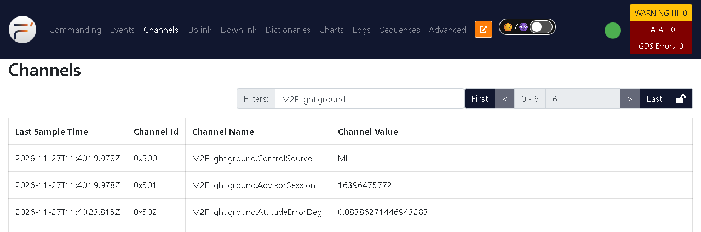
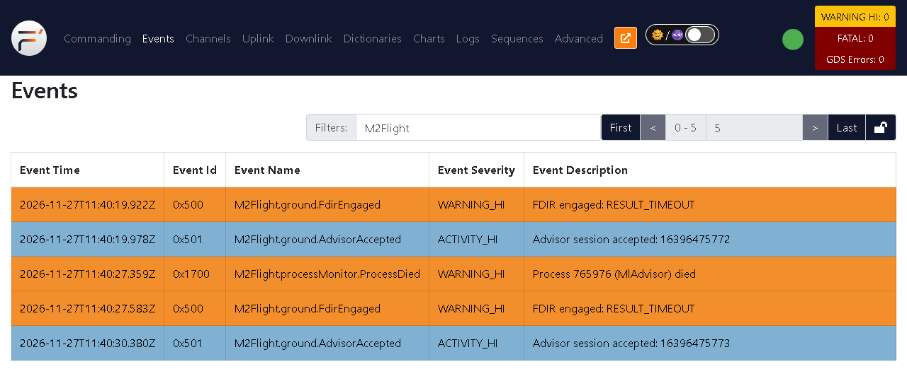

id: fprime-adcs-fault-recovery-on-qnx
title: Observe F Prime ADCS Fault Recovery on QNX 8.0
summary: Use F Prime GDS to observe an advisor process exit, deterministic FDIR takeover and the return of a replacement advisor supervised by QNX SLM.
categories: Porting & Open Source
tags: intermediate
platforms: QEMU, Ubuntu, Windows (WSL)
published: 2026-11-28
featured: false
status: published
authors: Yang
feedback_link: https://github.com/qnx/codelabs/issues

# Observe F Prime ADCS Fault Recovery on QNX 8.0

## Overview
Duration: 2:00

**Last verified** on 2026-11-27 at fprime-qnx commit `752c5d4d7786767744440089a1e2224db7e9e145` with QNX SDP 8.0.6 and a QNX 8.0.0 x86-64 QEMU/KVM guest under WSL2. Links to project documentation point to commit `f89c5c805072137cbb4501e6df660c7d96873fb4`, which changes only documentation after the verified commit.

The reference deployment simulates an attitude determination and control system (ADCS). `FlightSW` produces an attitude estimate and selects the control source. `MlAdvisor` runs in a separate QNX process and supplies advice through native QNX message passing. This exercise uses the built-in deterministic advisor to make the restart scenario reproducible.

Stop the advisor in a disposable guest and follow the recovery in F Prime's Ground Data System (GDS). GDS reports the process exit, and FlightSW switches to deterministic fault detection, isolation and recovery (FDIR) when the advisor's last result goes stale. QNX System Launch and Monitor (SLM) starts a replacement process. FlightSW returns to the advisor after accepting a valid result in its new session.

- **What you'll learn** Match the process-death event to the original PID, identify FDIR takeover, and distinguish a replacement PID from the fresh session that FlightSW accepts.
- **What you'll need** An x86-64 Ubuntu 24.04 host with KVM and libvirt (native Ubuntu or WSL2), QNX SDP 8.0.6 with x86-64 target support, and a browser that can reach GDS.

## System Set Up
Duration: 15:00

Install the Ubuntu packages, enable the libvirt `default` network with `virbr0`, and install your licensed QNX SDP through QNX Software Center. Use the Ubuntu filesystem for the build and the guest image. [Host setup](https://github.com/D1349375/fprime-qnx/blob/f89c5c805072137cbb4501e6df660c7d96873fb4/docs/en/host-setup.md)

Run these commands in Ubuntu to clone the repository at the revision this codelab was verified with.

```bash
git clone --no-checkout https://github.com/D1349375/fprime-qnx.git
cd fprime-qnx
git checkout --detach 752c5d4d7786767744440089a1e2224db7e9e145
git submodule update --init --recursive
git rev-parse HEAD
git submodule status --recursive
```

Install the F Prime tools pinned by the submodule. In each Ubuntu terminal you use for the build or runner, activate the SDK and virtual environment. Substitute your installation paths where needed. [QNX SDK and F Prime tools](https://github.com/D1349375/fprime-qnx/blob/f89c5c805072137cbb4501e6df660c7d96873fb4/docs/en/host-setup.md#qnx-sdk-and-f-prime-tools)

```bash
source "$HOME/qnx800/qnxsdp-env.sh"
source "$HOME/.venvs/fprime-qnx/bin/activate"
qcc -V
test -r /dev/kvm && test -w /dev/kvm && echo 'KVM OK'
virsh -c qemu:///system net-list --all
ip -brief -4 address show virbr0
command -v mkqnximage fprime-util fprime-gds fprime-cli
```

Check for the `gcc_ntox86_64` compiler target, `KVM OK`, an active `default` network, and an IPv4 address on `virbr0`.

## Cross-Build the Two Deployments
Duration: 10:00

From the repository root, build `FlightSW` and `MlAdvisor` for QNX. The same build generates the FlightSW dictionary that GDS uses to decode events and channels.

```bash
(
    cd FprimeQnxReference
    fprime-util generate qnx-x86_64
    fprime-util build qnx-x86_64 --jobs 2
)
ART=FprimeQnxReference/build-artifacts/qnx-x86_64
file "$ART/FlightSW/bin/FlightSW" "$ART/MlAdvisor/bin/MlAdvisor"
ls "$ART/FlightSW/dict/FlightTopologyDictionary.json"
```

The two executables should be x86-64 ELF files. The GDS runner loads this build's `FlightTopologyDictionary.json` automatically.

## Start GDS and Record the Baseline
Duration: 5:00

From the repository root, run the interactive check in a terminal that accepts input. Keep the terminal open. The runner creates a QNX guest, starts GDS, deploys the two processes and sends `CdhCore.cmdDisp.CMD_NO_OP`. It prints the path to an evidence directory before starting the guest. [Interactive runner](https://github.com/D1349375/fprime-qnx/blob/752c5d4d7786767744440089a1e2224db7e9e145/scripts/gds-check.sh)

```bash
mkdir -p "$HOME/fprime-qnx-evidence"
GDS_EVIDENCE_ROOT="$HOME/fprime-qnx-evidence" scripts/gds-check.sh --ui
```

The browser shows only the events and channel samples that arrive while the page is open. After the runner prints `GDS evidence:`, open [http://localhost:5000](http://localhost:5000/) in your browser and reload it until GDS answers, which happens before FlightSW starts. On WSL2, open the same URL in the Windows browser. Go to **Channels** and enter `M2Flight.ground` in **Filters**.

Wait for `Open Events, then press Enter here to stop the advisor.` Leave the terminal paused while you establish the baseline.

Open **Events** and enter `CdhCore.cmdDisp` in **Filters**. Look for `CdhCore.cmdDisp.NoOpReceived` and `CdhCore.cmdDisp.OpCodeCompleted`. If you opened the page after those events arrived, go to **Commanding**, select `CdhCore.cmdDisp.CMD_NO_OP` and click **Send Command**. Return to **Events** to see the response.

In **Channels**, with `M2Flight.ground` in **Filters**, read the values of `ControlSource` and `AdvisorSession`. Note the session shown alongside `ControlSource = ML`. The `ML` enum label identifies advisor-derived control in this deployment.

FlightSW sends these two channels only when they change. If the page opened after FlightSW started and they stay empty, read their latest values from the runner's capture in a second Ubuntu terminal. Keep that terminal for the later steps.

```bash
read -r -p 'GDS evidence directory: ' RUN
grep -E 'ControlSource|AdvisorSession' "$RUN/capture/channel.log" | tail -n 2
```



## Stop the Advisor and Read the Recovery Events
Duration: 5:00

Open **Events** again and enter `M2Flight` in **Filters**, then press **Enter** once in the runner terminal. The harness stops the staged `MlAdvisor` process in the guest. Wait for the second pause, which says `Press Enter here to continue with the reconnect check.` Leave it paused while you inspect the evidence.

Read the recovery events in timestamp order.

1. `M2Flight.processMonitor.ProcessDied` identifies the stopped `MlAdvisor` by PID.
2. `M2Flight.ground.FdirEngaged` marks the handover to deterministic FDIR. Its reason, `RESULT_TIMEOUT`, comes from FlightSW's freshness check on the last advisor result, so the handover does not depend on the death event.
3. A later `M2Flight.ground.AdvisorAccepted` identifies the fresh session that FlightSW accepted.

Check **Event Time** if the table order has changed. Rows before `ProcessDied` can include an `FdirEngaged` and `AdvisorAccepted` pair from the original process, for example when its first session times out during startup. Match the `AdvisorAccepted` after `ProcessDied` to the replacement PID in the next step.



## Verify the Replacement and Return to Advisor Control
Duration: 5:00

In **Channels**, read `M2Flight.ground.ControlSource` and `M2Flight.ground.AdvisorSession` again. The current source should be `ML` and the session should differ from the baseline. The brief `FDIR` state remains in the channel capture even after the live value returns to `ML`.


While the runner is paused, use the second Ubuntu terminal, or open one now and paste the directory printed after `GDS evidence:` when prompted.

```bash
[ -n "${RUN:-}" ] || read -r -p 'GDS evidence directory: ' RUN
cat "$RUN/sessions.csv"
awk -F, '$3 == "M2Flight.ground.ControlSource" && $5 != previous {
    print $5
    previous = $5
}' "$RUN/capture/channel.log"
```

`sessions.csv` lists `PID,session` pairs. Find the PID from `ProcessDied` and the row for the session currently shown in `AdvisorSession`. The current session must have a different PID. Match that session to its `AdvisorAccepted` event. The `ControlSource` capture should contain `ML → FDIR → ML` in that order. A session change of the original process before the stop adds another `FDIR → ML` pair ahead of it.

The replacement PID shows that SLM restarted the process. The fresh session in the event and channels shows that FlightSW accepted the replacement's advice. [SLM configuration template](https://github.com/D1349375/fprime-qnx/blob/752c5d4d7786767744440089a1e2224db7e9e145/FprimeQnxReference/qnx/m3-slm.xml.in) · [QNX SLM documentation](https://www.qnx.com/developers/docs/8.0/com.qnx.doc.neutrino.utilities/topic/s/slm.html)

## Finish the Checks and Stop the Guest
Duration: 3:00

Return to the runner terminal and press **Enter** a second time. The script disconnects and restarts GDS, checks that the same FlightSW process keeps producing output, sends a second NO-OP and shuts down FlightSW and its guest. Look for these checks in the terminal.

```text
PASS CMD_NO_OP round trip
PASS kernel death event for the watched advisor only
PASS FDIR and new advisor session
PASS control source and attitude telemetry
PASS FlightSW kept running and GDS reconnected
PASS SLM replaced the advisor and FlightSW accepted its session
PASS FlightSW shutdown
```

Check the recorded verdict from your second terminal.

```bash
cat "$RUN/final-verdict.txt"
```

The printed evidence directory stays on your machine. It records the source and dictionary revision, guest version and local application logs. Keep the generated image and SSH identity in that private directory.

## Troubleshooting and Next Steps
Duration: 3:00

- **No prompt before the fault** Check the terminal for `FAIL` and inspect `guest-boot.log` and `image/output/qemu.out` in the printed evidence directory. Confirm `default` is active before retrying.
- **Port 5000 is busy** Stop the GDS session you no longer need or run `GDS_GUI_PORT=5001 scripts/gds-check.sh --ui` with the same evidence directory setting. Open the matching web port. The runner selects a separate TCP port for the guest connection.
- **The page stops updating after the second Enter** The reconnect step restarts GDS and then stops the guest. Inspect `capture/event.log` and `capture/channel.log` for the recorded events and telemetry.

The codelab covers the simulated ADCS fault sequence on a QNX x86-64 guest. For the learned advisor, model replay, or deadline validation, follow the separate target checks. [Architecture](https://github.com/D1349375/fprime-qnx/blob/f89c5c805072137cbb4501e6df660c7d96873fb4/docs/en/architecture.md) · [Reproduction guide](https://github.com/D1349375/fprime-qnx/blob/f89c5c805072137cbb4501e6df660c7d96873fb4/docs/en/reproduce.md#adcs-ground-system)
