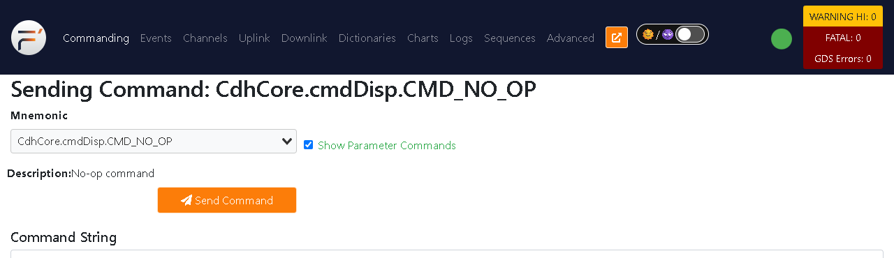
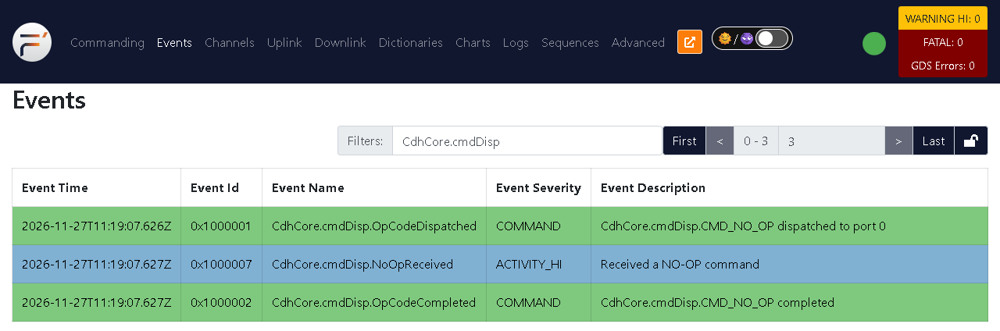

id: fprime-ref-on-qnx
title: Run the NASA F Prime Ref Deployment on QNX 8.0 with QEMU
summary: Cross-build the upstream F Prime Ref flight software deployment for QNX 8.0 x86-64, boot it in a QEMU/KVM guest and command it from the F Prime ground system.
categories: Porting & Open Source
tags: intermediate
platforms: QEMU, Ubuntu, Windows (WSL)
published: 2026-11-28
featured: false
status: published
authors: Yang
feedback_link: https://github.com/qnx/codelabs/issues

# Run the NASA F Prime Ref Deployment on QNX 8.0 with QEMU

## Overview
Duration: 3:00

**Last verified** on 2026-11-27 at fprime-qnx commit `752c5d4d7786767744440089a1e2224db7e9e145` with QNX SDP 8.0.6, Ubuntu 24.04 under WSL2, and a QNX 8.0.0 x86-64 QEMU/KVM guest. Links to project documentation point to commit `f89c5c805072137cbb4501e6df660c7d96873fb4`, which changes only documentation after the verified commit.

[F Prime](https://github.com/nasa/fprime) is the open-source flight software framework from NASA's Jet Propulsion Laboratory. Its `Ref` deployment is the reference application that ships with the framework: a set of components connected into a topology, driven by rate groups, and controlled from the F Prime ground data system (GDS).

In this codelab you take the upstream `Ref` from the pinned F Prime release, apply a small adoption patch, cross-build it for QNX 8.0 with the [fprime-qnx](https://github.com/D1349375/fprime-qnx/tree/f89c5c805072137cbb4501e6df660c7d96873fb4) platform library, and run it in a QNX 8.0 x86-64 guest under QEMU/KVM. Then you send a command from the GDS on your Linux host and watch the answer come back from QNX.

### What you'll build

* **On your Ubuntu host:** `fprime-gds` listens as a TCP server and serves its web UI.
* **In the QNX guest:** the `Ref` executable connects to the host as a TCP client over the libvirt `virbr0` bridge.
* **Inside `Ref`:** a QNX timer delivers a pulse each period, and every pulse drives the rate groups that produce telemetry.

### What you'll learn

* What an existing F Prime deployment has to change to build for QNX
* How the `qnx-x86_64` toolchain and the `Svc.QnxTimer` component plug into F Prime
* How to create and boot a headless QNX 8.0 guest with `mkqnximage`
* How to send `CMD_NO_OP` from the GDS and read the events and telemetry that come back

### What you'll need

* An x86-64 computer with hardware virtualization enabled, running Ubuntu 24.04, either natively or under WSL2 on Windows
* A myQNX account with a [QNX SDP 8.0 non-commercial license](https://www.qnx.com/products/everywhere/) and [QNX Software Center](https://www.qnx.com/download/group.html?programid=29178)
* Basic familiarity with the Linux shell, Git and CMake

<aside class="negative">
F Prime on QNX is an independent project. This exercise covers a QNX 8.0.0 x86-64 guest under QEMU/KVM.
</aside>

---

## System Set Up
Duration: 15:00

The project keeps its host setup instructions in one place, the [fprime-qnx host setup guide](https://github.com/D1349375/fprime-qnx/blob/f89c5c805072137cbb4501e6df660c7d96873fb4/docs/en/host-setup.md). Follow it for the package list, the guest network and the QNX SDK. This step summarizes what it sets up and how to check each part.

Run every command in this codelab in an Ubuntu 24.04 shell. Keep the checkout on the Linux filesystem (for example under `$HOME`), not on a Windows drive mounted under `/mnt`. On Windows, use Ubuntu 24.04 under [WSL](https://learn.microsoft.com/en-us/windows/wsl/install) version `2` with [systemd enabled](https://learn.microsoft.com/en-us/windows/wsl/systemd).

### Linux tools, KVM and the guest network

Install the packages listed under [Linux tools and guest network](https://github.com/D1349375/fprime-qnx/blob/f89c5c805072137cbb4501e6df660c7d96873fb4/docs/en/host-setup.md#linux-tools-and-guest-network). They include the compilers and build tools, Python, the SSH client, QEMU and libvirt.

The QNX guest gets its address from the libvirt `default` network and reaches your host through the `virbr0` bridge. Start that network and allow the QEMU bridge helper to use `virbr0` as shown in the [QSTI on QEMU using WSL codelab](https://qnx.github.io/codelabs/qsti-qemu-on-wsl/index.html). The same steps apply to native Ubuntu.

QEMU runs as your own user in this codelab. Check that your account can open the KVM device and query the system libvirt instance, that the `default` network is active, and that `virbr0` has an IPv4 address:

```bash
test -r /dev/kvm && test -w /dev/kvm && echo "KVM OK"
virsh -c qemu:///system net-list --all
ip -brief address show virbr0
```

### QNX SDP 8.0

Install QNX SDP 8.0 with the x86-64 target through QNX Software Center, as described under [QNX SDK and F Prime tools](https://github.com/D1349375/fprime-qnx/blob/f89c5c805072137cbb4501e6df660c7d96873fb4/docs/en/host-setup.md#qnx-sdk-and-f-prime-tools). The project was verified with SDP 8.0.6. The installation must provide `qcc`, `q++` and `mkqnximage`. The examples assume the location `$HOME/qnx800`.

```bash
source "$HOME/qnx800/qnxsdp-env.sh"
qcc -V
```

The output must list `gcc_ntox86_64`.

<aside class="positive">
Every new terminal needs <code>source "$HOME/qnx800/qnxsdp-env.sh"</code> before the build and guest commands. The toolchain and the scripts read <code>QNX_HOST</code> and <code>QNX_TARGET</code> from it.
</aside>

---

## Get the Source and the F Prime Tools
Duration: 10:00

### Clone the port at a known revision

The repository pins upstream F Prime v4.4.2 as a Git submodule. Clone it in Ubuntu at the revision this codelab was verified with.

```bash
git clone --no-checkout https://github.com/D1349375/fprime-qnx.git
cd fprime-qnx
git checkout --detach 752c5d4d7786767744440089a1e2224db7e9e145
git submodule update --init --recursive
git rev-parse HEAD
git submodule status --recursive
```

### Install the F Prime tools

From the repository root, create the Python virtual environment and install the F Prime tools pinned by the submodule, following [QNX SDK and F Prime tools](https://github.com/D1349375/fprime-qnx/blob/f89c5c805072137cbb4501e6df660c7d96873fb4/docs/en/host-setup.md#qnx-sdk-and-f-prime-tools). The examples assume the environment at `$HOME/.venvs/fprime-qnx`.

Confirm that the QNX and F Prime tools are on your `PATH`:

```bash
command -v qcc mkqnximage fprime-util fprime-gds fprime-cli
```

All five commands must print a path. In every new terminal, run both `source` lines again from the repository root:

```bash
source "$HOME/qnx800/qnxsdp-env.sh"
source "$HOME/.venvs/fprime-qnx/bin/activate"
```

---

## What Ref Changes for QNX
Duration: 5:00

Before building, look at how little an existing deployment has to change. The repository keeps the platform support in a library, `FprimeQnx`, and keeps the deployment changes in one patch, [`adoption/ref-qnx.patch`](https://github.com/D1349375/fprime-qnx/blob/752c5d4d7786767744440089a1e2224db7e9e145/adoption/ref-qnx.patch).

### 1. Register the platform library

The F Prime project file [`adoption/settings.ini`](https://github.com/D1349375/fprime-qnx/blob/752c5d4d7786767744440089a1e2224db7e9e145/adoption/settings.ini) keeps the framework on the pinned release and adds `FprimeQnx` as a library:

```ini
[fprime]
project_root: .
framework_path: ../lib/fprime
library_locations: ../FprimeQnx
```

The library supplies the `qnx-x86_64` toolchain file, the QNX platform selection with the POSIX OSAL, and QNX-specific components.

### 2. Drive the rate groups with a QNX timer

Upstream `Ref` uses `Svc.LinuxTimer` to start its rate groups. The patch changes only the instance type and keeps the instance name, so its connections and its start and quit calls stay the same:

```diff
-  instance linuxTimer: Svc.LinuxTimer base id 0x10024000
+  # QNX: pulse-driven rate group timer from the FprimeQnx library (same startTimer/quit API as Svc.LinuxTimer)
+  instance linuxTimer: Svc.QnxTimer base id 0x10024000
```

[`Svc.QnxTimer`](https://github.com/D1349375/fprime-qnx/blob/752c5d4d7786767744440089a1e2224db7e9e145/FprimeQnx/Svc/QnxTimer/QnxTimer.fpp) creates a periodic POSIX timer on `CLOCK_MONOTONIC` that delivers a QNX pulse to a private channel. Each pulse produces one `CycleOut` call to the rate group driver.

### 3. Leave out a component the target cannot build

The upstream `Ref` also contains `Svc.WasmSequencer`, which needs a Rust toolchain for the target. The patch removes the `wasmSeq` instance, its connections and its telemetry packet entries, and keeps the classic command sequencer `cmdSeq`.

### Generate the patched Ref

The script [`scripts/import-ref.sh`](https://github.com/D1349375/fprime-qnx/blob/752c5d4d7786767744440089a1e2224db7e9e145/scripts/import-ref.sh) copies `Ref` from the pinned F Prime submodule into `adoption/Ref` and applies the patch:

```bash
bash scripts/import-ref.sh
```

It prints the upstream version it used, followed by `+ ref-qnx.patch`. If the patch fails after you move the submodule to another F Prime release, upstream `Ref` changed and the patch needs a review.

---

## Cross-Build Ref for QNX
Duration: 10:00

From the `adoption` directory, generate the build for the `qnx-x86_64` toolchain and build it:

```bash
cd adoption
fprime-util generate qnx-x86_64
fprime-util build qnx-x86_64 -j 2
cd ..
```

The build writes the QNX executable and the ground dictionary under `adoption/build-artifacts/qnx-x86_64/Ref/`:

```bash
file adoption/build-artifacts/qnx-x86_64/Ref/bin/Ref
ls adoption/build-artifacts/qnx-x86_64/Ref/dict/RefTopologyDictionary.json
```

`file` reports an x86-64 ELF executable. The GDS uses the dictionary to decode the commands, events and telemetry of this exact build.

<aside class="negative">
Run <code>fprime-util</code> with the QNX SDP environment and the virtual environment both active. Without them the toolchain cannot find <code>qcc</code> or the target libraries.
</aside>

---

## Create and Boot a QNX Guest
Duration: 10:00

[`mkqnximage`](https://www.qnx.com/developers/docs/8.0/com.qnx.doc.neutrino.utilities/topic/m/mkqnximage.html) from QNX SDP builds a small QNX 8.0 image for QEMU. The commands below use the same options as the project's scripts.

### Create an SSH key and an image directory

Keep this Ubuntu terminal open for the guest and SSH commands. Create a private run directory and put the key and host-key file beside the empty image directory.

```bash
mkdir -p "$HOME/fprime-qnx-evidence"
REF_RUN="$(mktemp -d "$HOME/fprime-qnx-evidence/ref.XXXXXXXX")"
export QNX_IMAGE_DIR="$REF_RUN/image"
export QNX_SSH_KEY="$REF_RUN/id_ed25519"
export QNX_KNOWN_HOSTS="$REF_RUN/known_hosts"
mkdir "$QNX_IMAGE_DIR"
ssh-keygen -q -t ed25519 -N '' -f "$QNX_SSH_KEY"
```

### Build the image

```bash
(
    cd "$QNX_IMAGE_DIR"
    mkqnximage --noprompt --type=qemu --arch=x86_64 --cpu=2 --ram=1536M \
        --hostname=fprime-ref --ssh-ident="$QNX_SSH_KEY.pub" --build
)
```

### Boot it headless

```bash
(cd "$QNX_IMAGE_DIR" && mkqnximage --run=-h)
```

QEMU keeps running in the background. Its process ID is in `$QNX_IMAGE_DIR/output/qemu.pid`.

### Find the guest and log in

Ask `mkqnximage` for the guest address. Repeat the command if it prints nothing. If SSH still fails after the guest had time to boot, check the serial log in Troubleshooting.

```bash
GUEST="$(cd "$QNX_IMAGE_DIR" && mkqnximage --getip | grep -E '^[0-9]+(\.[0-9]+){3}$' | tail -1)"
echo "$GUEST"
```

You can also look the address up in the lease table of the `default` network with `virsh -c qemu:///system net-dhcp-leases default`.

Once the address is available, set the SSH options and log in.

```bash
SSH_OPTS=(-i "$QNX_SSH_KEY" -o BatchMode=yes -o ConnectTimeout=5
          -o StrictHostKeyChecking=accept-new -o "UserKnownHostsFile=$QNX_KNOWN_HOSTS")
ssh "${SSH_OPTS[@]}" "root@$GUEST" uname -a
```

Check that the output begins with `QNX fprime-ref 8.0.0` and ends with `x86pc x86_64`.

<aside class="positive">
Use a new run directory for each new image. Each directory has its own SSH identity and known-hosts file.
</aside>

---

## Send a NO-OP from the GDS
Duration: 10:00

Open a second Ubuntu terminal for GDS. Keep the original terminal for the guest, with `GUEST` and `SSH_OPTS` from the previous step.

### Start GDS in the new terminal

From the repository root, activate the SDK and the F Prime virtual environment. Start `fprime-gds` as a TCP server on port `50000` using the dictionary from your build. The `-n` option tells GDS to leave deployment startup to you.

```bash
HOST_IP="$(ip -4 -o addr show virbr0 | awk '{print $4}' | cut -d/ -f1)"
GDS_LOG_DIR="$(mktemp -d "$HOME/fprime-qnx-evidence/ref-gds.XXXXXXXX")"
fprime-gds -n --skip-browser-open \
    --dictionary adoption/build-artifacts/qnx-x86_64/Ref/dict/RefTopologyDictionary.json \
    --framing-selection space-packet-space-data-link \
    --ip-address "$HOST_IP" --ip-port 50000 -l "$GDS_LOG_DIR" --log-directly
```

Leave GDS running. If TCP port `50000` is busy, use an unused port here and in the `Ref` command below.

Open [http://localhost:5000](http://localhost:5000/) in your browser. Under WSL2, open the same URL in your Windows browser. Go to **Channels** and enter `rateGroup1Comp` in **Filters** before starting `Ref` so that you can see the initial samples. [Windows localhost access](https://learn.microsoft.com/en-us/windows/wsl/networking#accessing-linux-networking-apps-from-windows-localhost)

### Copy and start Ref from the original terminal

`Ref` connects to the host address on the `virbr0` bridge. Run this from the repository root in the terminal where you set up the guest.

```bash
HOST_IP="$(ip -4 -o addr show virbr0 | awk '{print $4}' | cut -d/ -f1)"
ssh -n "${SSH_OPTS[@]}" "root@$GUEST" 'mkdir -p /tmp/fprime-ref'
scp "${SSH_OPTS[@]}" adoption/build-artifacts/qnx-x86_64/Ref/bin/Ref "root@$GUEST:/tmp/fprime-ref/Ref"
ssh -n -f "${SSH_OPTS[@]}" "root@$GUEST" \
    "cd /tmp/fprime-ref && nohup ./Ref -a $HOST_IP -p 50000 > ref.log 2>&1 < /dev/null &"
```

The `-f` option lets SSH return while `Ref` keeps running. If the channels remain empty, check that the `Ref` console log ends with a TCP connection to the bridge IP and port you chose.

```bash
ssh -n "${SSH_OPTS[@]}" "root@$GUEST" 'tail -n 12 /tmp/fprime-ref/ref.log'
```

### Check the telemetry and send the command

1. In **Channels**, check that at least one `Ref.rateGroup1Comp` row has a **Last Sample Time** and **Channel Value**. The dictionary can list the channel before a sample arrives. With the page open, start or restart `Ref` if the initial value was missed.
2. Open **Commanding**. Select `CdhCore.cmdDisp.CMD_NO_OP` in **Mnemonic** and click **Send Command**. The command takes no arguments.



Open **Events** and enter `CdhCore.cmdDisp` in **Filters**. Check that the QNX guest returned both events.

- `CdhCore.cmdDisp.NoOpReceived` comes from the NO-OP handler.
- `CdhCore.cmdDisp.OpCodeCompleted` confirms that the command completed.



### Stop Ref and the GDS

In the original terminal, stop `Ref` in the guest.

```bash
ssh "${SSH_OPTS[@]}" "root@$GUEST" 'slay -f Ref'
```

In the GDS terminal, press **Ctrl+C**. Keep the guest running for the script check.

---

## Check the Round Trip with a Script
Duration: 5:00

The repository automates the same round trip in [`scripts/ref-gds-check.sh`](https://github.com/D1349375/fprime-qnx/blob/752c5d4d7786767744440089a1e2224db7e9e145/scripts/ref-gds-check.sh). It starts the GDS without the web UI, copies `Ref` to the guest, starts the telemetry and event listeners, and launches `Ref`. It waits for telemetry before sending `CMD_NO_OP` with `fprime-cli`.

Run it against the guest you booted, with the same environment variables:

```bash
QNX_IMAGE_DIR="$QNX_IMAGE_DIR" QNX_SSH_KEY="$QNX_SSH_KEY" QNX_KNOWN_HOSTS="$QNX_KNOWN_HOSTS" \
    scripts/ref-gds-check.sh
```

The script ends with three checks:

```text
[ref-gds-check] PASS: NoOpReceived event downlinked from target
[ref-gds-check] PASS: OpCodeCompleted event downlinked from target
[ref-gds-check] PASS: rate group 1 telemetry downlinked from target
```

Each `PASS` line is followed by the matching line from the downlink. The script prints its log directory under `adoption/logs/`, with the GDS logs, the `uname` of the target and the target console log.

<aside class="positive">
If port <code>50000</code> is busy, set <code>GDS_PORT</code> to a free port. If the listeners need longer to discover telemetry, raise <code>CHECK_SECONDS</code>. For example: <code>GDS_PORT=51000 CHECK_SECONDS=90 scripts/ref-gds-check.sh</code>.
</aside>

---

## Clean Up
Duration: 2:00

Stop the guest you booted:

```bash
(cd "$QNX_IMAGE_DIR" && mkqnximage --stop)
```

Check that no GDS processes are left over, because they can hold the TCP port and the GDS message endpoints:

```bash
pgrep -af 'fprime_gds|fprime-gds'
```

If a GDS process from this codelab is still listed a few seconds after **Ctrl+C**, press **Ctrl+C** again in the GDS terminal or stop that process by its PID with `kill`. The repository scripts stop their own GDS processes, and send `SIGKILL` to any that do not exit within 10 seconds of `SIGTERM`.

The image directory, the SSH key and the log directories stay on your machine. Delete them when you no longer need them.

### Rebuild everything from scratch

After you stop the manual guest, [`scripts/clean-rebuild.sh`](https://github.com/D1349375/fprime-qnx/blob/752c5d4d7786767744440089a1e2224db7e9e145/scripts/clean-rebuild.sh) clones the checkout into a new work directory, generates and builds `Ref`, creates a fresh QNX image with a new SSH key, and runs the same round-trip check:

```bash
scripts/clean-rebuild.sh "$(mktemp -d "$HOME/fprime-qnx-evidence/ref-clean.XXXXXXXX")"
```

The last line reads `PASS: clean clone, build, QNX boot and Ref/GDS check`. The work directory it prints holds `logs/source.log` (source and SDK versions), `logs/build.log`, `logs/image.log` and `logs/ref-gds.log`. The script stops its own guest when it finishes.

---

## Troubleshooting
Duration: 3:00

### The guest never gets an address

Check that the libvirt `default` network is active with `virsh -c qemu:///system net-list --all`. If it is inactive, start it using the [host setup guide](https://github.com/D1349375/fprime-qnx/blob/f89c5c805072137cbb4501e6df660c7d96873fb4/docs/en/host-setup.md#linux-tools-and-guest-network).

If the network is active, inspect the guest serial log.

```bash
tail -n 30 "$QNX_IMAGE_DIR/output/qemu.out"
```

If the log reports `Unable to access /dev/hd0` or `No system file system, giving up`, the disk driver started after the startup script stopped waiting for it. The image itself is fine. Keep a copy of the log, then restart the same image and wait for SSH again before starting GDS. The repository scripts, such as `scripts/clean-rebuild.sh`, detect this message and restart the image once on their own.

```bash
cp "$QNX_IMAGE_DIR/output/qemu.out" "$REF_RUN/first-boot.log"
(cd "$QNX_IMAGE_DIR" && mkqnximage --stop)
(cd "$QNX_IMAGE_DIR" && mkqnximage --run=-h)
```

### The GDS reports that the port is in use

An old GDS may still be running. Find the process that holds the port and stop it, or use another port:

```bash
ss -ltnp 'sport = :50000'
pgrep -af 'fprime_gds|fprime-gds'
```

### `fprime-util` or the scripts cannot find the QNX tools

Run `source "$HOME/qnx800/qnxsdp-env.sh"` and activate the virtual environment in the same terminal, then check again with `command -v qcc mkqnximage fprime-util fprime-gds fprime-cli`.

### SSH refuses the guest's host key

Use a new run directory and known-hosts file for a newly built guest. Check that `GUEST` resolves to the image you intended to boot before accepting its key.

---

## Next Steps
Duration: 3:00

### Adopt the port in your own deployment

The same four steps apply to an existing F Prime deployment:

1. Add the directory that contains `FprimeQnx/library.cmake` to `library_locations` in the project's `settings.ini`.
2. Activate the QNX SDP environment and run `fprime-util generate qnx-x86_64` and `fprime-util build qnx-x86_64`.
3. Change rate group timers of type `Svc.LinuxTimer` to `Svc.QnxTimer` and keep their cycle output connections.
4. Review platform-specific drivers and components, then run your own GDS, hardware and integration checks.

The [adoption guide](https://github.com/D1349375/fprime-qnx/blob/f89c5c805072137cbb4501e6df660c7d96873fb4/docs/en/adopt.md) explains each step. The project applied the same steps to the F Prime [MathComponent tutorial](https://github.com/fprime-community/fprime-tutorial-math-component), an existing deployment with its own components, ports, types and parameter. Its [two-line patch](https://github.com/D1349375/fprime-qnx/blob/752c5d4d7786767744440089a1e2224db7e9e145/adoption/math-qnx.patch) registers the library and switches the timer, and the [reproduction steps](https://github.com/D1349375/fprime-qnx/blob/f89c5c805072137cbb4501e6df660c7d96873fb4/docs/en/reproduce.md#mathcomponent-tutorial-adoption) run its commands and unit tests on the QNX guest.

### Know the limits

* This run covers the QNX 8.0.0 x86-64 guest on QEMU/KVM under Ubuntu 24.04 and WSL2. AArch64 execution and physical hardware remain outside its target coverage.
* The stock F Prime POSIX UART driver is excluded from QNX builds because the SDK headers lack two symbols it uses. The project reported this upstream in [nasa/fprime#6437](https://github.com/nasa/fprime/issues/6437).
* `Ref` on QNX omits the Rust-based `WasmSequencer` and keeps `cmdSeq`.
* This codelab does not measure timing. The limitations page describes the project's test environment. Native Linux/KVM and physical hardware were not run.

The [limitations page](https://github.com/D1349375/fprime-qnx/blob/f89c5c805072137cbb4501e6df660c7d96873fb4/docs/en/limitations.md) has the full list.

### Go further

* The [ADCS reference](https://github.com/D1349375/fprime-qnx/tree/752c5d4d7786767744440089a1e2224db7e9e145/FprimeQnxReference) splits flight software and an advisor into two processes that use native QNX message passing and SLM supervision. Its GDS check shows a fault, the recovery and a supervised restart. [Reproduction guide](https://github.com/D1349375/fprime-qnx/blob/f89c5c805072137cbb4501e6df660c7d96873fb4/docs/en/reproduce.md)
* Follow the platform discussion with the F Prime maintainers in [nasa/fprime discussion #6436](https://github.com/nasa/fprime/discussions/6436).
* Read the F Prime [platform porting guide](https://fprime.jpl.nasa.gov/v4.4.0/docs/how-to/integrate/porting-guide/) and the [GDS documentation](https://fprime.jpl.nasa.gov/v4.4.0/docs/user-manual/overview/gds-introduction/).
