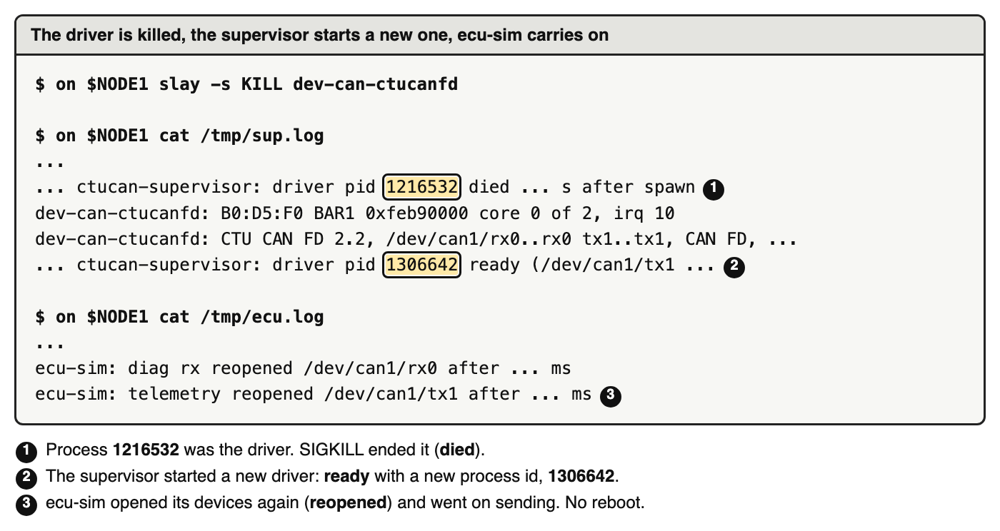
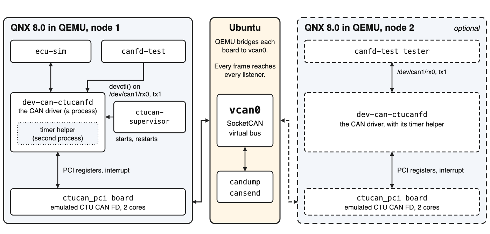
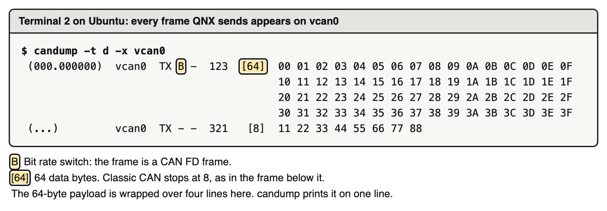
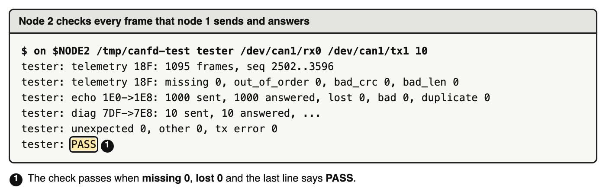
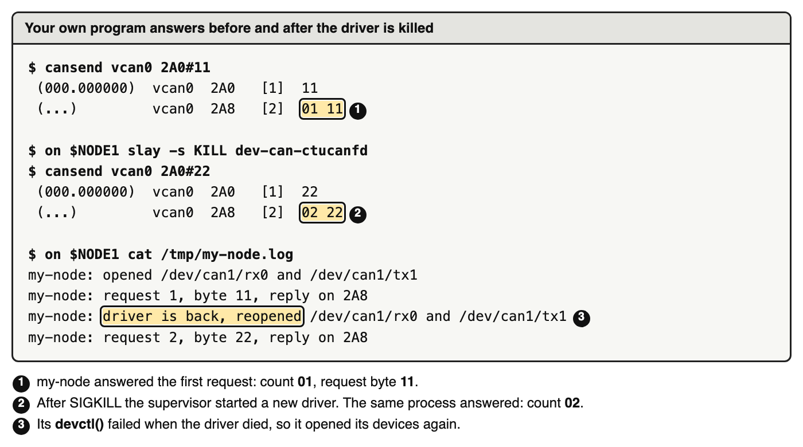

id: qnx-canfd-qemu
title: Test CAN FD software on QNX 8.0 in QEMU, no CAN board needed
summary: Run a native QNX 8.0 CAN FD driver on an emulated board, kill it, and watch a supervisor and your own C program carry on.
categories: Automotive & CAN, Drivers & Services
tags: intermediate
platforms: QEMU, Ubuntu
published: 2026-11-20
featured: false
status: published
authors: Yashaswin Sharma Puranik, Nikhil Reddy Gogu
feedback_link: https://github.com/qnx/codelabs/issues


# Test CAN FD software on QNX 8.0 in QEMU, no CAN board needed

## What you will build
Duration: 2:00

You will kill a CAN driver with SIGKILL while a simulated ECU (electronic control unit) is sending on it, and the target will not reboot. A supervisor starts a new driver under a new process id, and the ECU opens its devices again and goes on sending:



Then you write a CAN program of your own in C, kill the driver under it, and see the same process answer before and after the crash.

You need no CAN hardware. QEMU emulates `ctucan_pci`, a PCI board with the CTU CAN FD core, an open source CAN FD controller (CAN FD frames carry up to 64 data bytes; classic CAN stops at 8). You boot QNX OS 8.0 in QEMU with that board, run **dev-can-ctucanfd**, a QNX driver for the core built on the QNX CAN Driver Development Kit (libcan), and connect the emulated bus to SocketCAN on Linux, so the usual Linux CAN tools can send and watch frames.

The setup is one QNX target, plus an optional second one on the right:



**What you will do:**

* Create a virtual CAN FD interface on your machine
* Boot QNX OS 8.0 in QEMU with an emulated CTU CAN FD PCI board
* Build and start the driver, and send CAN FD frames both ways
* Run a simulated battery ECU that sends telemetry every 10 ms and answers a diagnostic request
* Kill the driver while the ECU is sending, and watch a supervisor start it again
* Write a small CAN program of your own in C, and see it survive a driver crash
* Optionally, add a second QNX node on the same bus and check every frame that passes between the two

**What you will learn about QNX:** a CAN driver on QNX is an ordinary process. libcan makes it a resource manager, a process that serves path names in `/dev`: applications open `/dev/can1/rx0` and `/dev/can1/tx1` and read and write frames with `devctl()`, the QNX call that sends a command to a driver. When the driver dies, the kernel, the applications and your shell keep running. The supervisor has asked the process manager to notify it of every process death (`procmgr_event_notify()`), so it learns of the crash and starts the driver again.

The outputs shown are from runs on Ubuntu 22.04 with QNX SDP 8.0 and QEMU 6.2, trimmed: long lines end in `...`, and paths in your home directory start with `~`. Your addresses and process ids will differ. Measured times and clock timestamps are shown as `...`: QEMU models no CAN bit timing, so the times you see only say how fast QEMU and QNX move frames on your machine.

---

## Before you begin
Duration: 10:00

You need:

1. **QNX SDP 8.0 with a free non-commercial license.** If you do not have one yet, follow the QNX codelab [How to get a Free Non-commercial QNX License](https://qnx.github.io/codelabs/get-non-commercial-qnx-license/), then install QNX SDP 8.0 with the QNX Software Center. The commands assume it is in `~/qnx800`, so that `~/qnx800/qnxsdp-env.sh` exists.
2. **Ubuntu 22.04 (x86_64) with KVM**. Install QEMU, libvirt (mkqnximage targets get their address from libvirt's default network), `net-tools` (its `arp` command is how `mkqnximage --getip` finds a target's address), the Linux CAN tools and the kernel module package that holds `vcan`:

    ```bash
    sudo apt update
    sudo apt install qemu-system-x86 libvirt-daemon-system net-tools can-utils \
        git make openssh-client linux-modules-extra-$(uname -r)
    sudo adduser $USER kvm
    sudo adduser $USER libvirt
    ```

    Log out and in again after `adduser`. Then check the network, let mkqnximage's own script allow QEMU to use libvirt's `virbr0` bridge, and check that your QEMU has the CAN FD board:

    ```bash
    virsh -c qemu:///system net-list
    ~/qnx800/host/common/mkqnximage/qemu/check-net
    qemu-system-x86_64 -device ctucan_pci,help
    ```

    `virsh` should list `default` as `active`. If `default` is missing, `virsh -c qemu:///system net-list --all` also lists inactive networks; start an inactive one with `virsh -c qemu:///system net-start default`. `check-net` prints nothing when QEMU may already use `virbr0`; otherwise it asks once for your sudo password. The last command lists the board's properties:

    ```text
    ctucan_pci options:
      acpi-index=<uint32>    -  (default: 0)
      ...
      canbus0=<link<can-bus>>
      canbus1=<link<can-bus>>
      ...
    ```

<aside>
    <strong>Note:</strong> the commands in this codelab run as root on QNX virtual machines and use <code>sudo</code> on your machine to create a virtual CAN interface. Use a machine where that is allowed. The packages, the two group memberships and the permission that <code>check-net</code> gives QEMU stay on your machine after the clean-up step.
</aside>

---

## Get the code and build it
Duration: 3:00

Everything this codelab builds goes into `~/canfd-lab`. It must be a new directory, because the clean-up step deletes it. Create it, with an SSH key for the lab targets inside it:

```bash
mkdir ~/canfd-lab &&
    ssh-keygen -q -t ed25519 -N '' -C canfd-lab -f ~/canfd-lab/id_lab
```

If `mkdir` reports `File exists`, stop here: move that directory away or delete it first. The key has no passphrase, so the commands below log in to the targets without asking. It is used only for this lab, your own keys in `~/.ssh` are not touched, and the clean-up step deletes it with the directory.

Then write a small file that every terminal you open will read: it sets up the QNX SDP environment, names the two target directories, and defines `on` (run a command as root on a target), `put` (copy files to `/tmp` on a target) and `wait_ssh` (wait until a target answers on SSH).

```bash
cat > ~/canfd-lab/env.sh <<'EOF'
source ~/qnx800/qnxsdp-env.sh > /dev/null
export LAB=~/canfd-lab
export NODE1=$LAB/node1 NODE2=$LAB/node2
SSHOPT="-i $LAB/id_lab -o IdentitiesOnly=yes"
SSHOPT="$SSHOPT -o UserKnownHostsFile=$LAB/known_hosts"
SSHOPT="$SSHOPT -o StrictHostKeyChecking=accept-new"
SSHOPT="$SSHOPT -o LogLevel=ERROR -o ConnectTimeout=5"
ip_of() { (cd $1 && mkqnximage --getip); }
on()  { local d=$1; shift; ssh -n $SSHOPT root@$(ip_of $d) "$@"; }
put() { local d=$1; shift; scp -q $SSHOPT "$@" root@$(ip_of $d):/tmp/; }
wait_ssh() {
  local i
  for i in $(seq 60); do on $1 true 2> /dev/null && return; sleep 2; done
  echo "no SSH answer from $1, address: '$(ip_of $1)'"; return 1
}
EOF
source ~/canfd-lab/env.sh
```

`ip_of` runs `mkqnximage --getip` in a target's directory, which prints the address libvirt gave that target. The host keys of your QNX targets go into `~/canfd-lab/known_hosts`, so they do not mix with your own.

Now clone the driver, check out the commit this codelab was tested with, and build it:

```bash
cd $LAB
git clone https://github.com/NikhilGogu/qnx-ctucanfd.git
cd qnx-ctucanfd
git checkout -q 7502c47df99c3d9a6644d663f3686dd23ac0ef19
make
ls build/x86_64
```

```text
canfd-test      ctucan-latprobe  ctucan-supervisor  ecu-sim
ctucan-hangsrv  ctucan-probe     dev-can-ctucanfd
```

The build produced seven programs:

* `dev-can-ctucanfd`: the driver. It links libcan from the SDP statically.
* `canfd-test`: a test client that sends and receives frames through the driver's devices.
* `ecu-sim`: a simulated battery-management ECU.
* `ctucan-supervisor`: starts the driver again when it dies.
* `ctucan-probe`: reads the board's identification registers.
* `ctucan-hangsrv` and `ctucan-latprobe`: helpers for the driver's tests; you will not need them here.

Check: `ls build/x86_64` lists the seven programs.

---

## Create the virtual CAN bus
Duration: 2:00

On Linux, `vcan` is a virtual CAN interface: every frame one program sends on it reaches every other program listening on it. QEMU will connect its emulated CAN bus to it. The repository has a script for this:

```bash
scripts/host-vcan.sh vcan0
```

```text
6: vcan0: <NOARP,UP,LOWER_UP> mtu 72 qdisc noqueue state UNKNOWN mode ...
    link/can  promiscuity 0 minmtu 0 maxmtu 0
    vcan numtxqueues 1 numrxqueues 1 gso_max_size 65536 gso_max_segs ...
```

The script loads the `vcan` module, creates `vcan0`, sets its MTU to 72 and brings it up. 72 bytes is the size of a Linux CAN FD frame structure: QEMU passes CAN FD frames to a host interface only when that interface has this MTU.

Check: the first line of the output shows `mtu 72` and `UP`.

---

## Start a QNX target with a CAN FD board
Duration: 5:00

`mkqnximage` is the QNX SDP's script for building QNX images for development. Build an x86_64 image for QEMU in `$NODE1`, with the lab key for root:

```bash
mkdir -p $NODE1 && cd $NODE1
mkqnximage --type=qemu --arch=x86_64 --noprompt \
    --ssh-ident=$LAB/id_lab.pub --run=-h > $NODE1.log
cd $LAB/qnx-ctucanfd
grep '^QEMU Command:' $NODE1.log
```

```text
QEMU Command: qemu-system-x86_64 -smp 2 --enable-kvm --cpu host -m 1G -drive ...
```

`--run=-h` built the image and booted it without a display, and mkqnximage logged the exact QEMU command it used: 2 CPUs, 1 GB of RAM, the disk image, a network card on libvirt's `virbr0` and the QNX kernel image. That command has no CAN hardware. `scripts/qemu-can.sh` stops that QEMU and starts the same command again in the background (`-display none -daemonize` in place of `-nographic`), with a monitor socket in the target's directory that the clean-up step uses, and with three CAN options:

```text
-object can-bus,id=canbus0-bus
-object can-host-socketcan,id=canhost0,if=vcan0,canbus=canbus0-bus
-device ctucan_pci,canbus0=canbus0-bus,canbus1=canbus0-bus
```

The first creates a CAN bus inside QEMU, the second connects that bus to `vcan0` on your machine, and the third adds the CTU CAN FD PCI board. The board has two CAN FD cores, and QEMU refuses to start it unless both are connected to a bus, so both go on the same one. Start the target with them:

```bash
scripts/qemu-can.sh $NODE1 vcan0
wait_ssh $NODE1
on $NODE1 uname -a
```

```text
stopping QEMU pid 5448, which runs this target
started pid 5498 with ctucan_pci on canbus0 <-> vcan0
QNX noname 8.0.0 2026/10/30-09:10:05EDT x86pc x86_64
```

`wait_ssh` tries every 2 seconds until the target answers on SSH, and gives up after 60 tries. If it gives up, the address it prints tells you where to look: an empty address means libvirt gave the target none (check the `default` network from Before you begin), and an address means the target is up but SSH failed (read `$NODE1.log`). Now copy the programs to the target and look at the board from QNX:

```bash
put $NODE1 $(find build/x86_64 -type f)
on $NODE1 /tmp/ctucan-probe
```

```text
found 1760:ff00 at B0:D5:F0
irq: 10 (of 1)
BAR0: MEM addr=0xfeba0000 size=0x8000
BAR1: MEM addr=0xfeb90000 size=0x10000
BAR0+0x0000 bridge id: 0xc0000002 (cores=2)
core0 DEVICE_ID=0xcafd VERSION=2.2 (raw 0x0202cafd) OK
core0 MODE=0x00000010 STATUS=0x00000084 RX_MEM_INFO=0x08000800 ...
core0 FILTER_STATUS=0x0000 filters present: none
core1 DEVICE_ID=0xcafd VERSION=2.2 (raw 0x0202cafd) OK
...
```

The probe found the board through the QNX PCI server, mapped its two memory regions and read each core's registers: `0xCAFD` is the CTU CAN FD device id, version 2.2. `FILTER_STATUS` says which hardware acceptance filters the core has; QEMU's model has none, so the driver filters frames in software.

Check: the probe prints `DEVICE_ID=0xcafd ... OK` for `core0`.

---

## Start the driver
Duration: 3:00

Start the driver as root on the target:

```bash
on $NODE1 /tmp/dev-can-ctucanfd
on $NODE1 ls /dev/can1
```

```text
dev-can-ctucanfd: B0:D5:F0 BAR1 0xfeb90000 core 0 of 2, irq 10
dev-can-ctucanfd: CTU CAN FD 2.2, /dev/can1/rx0..rx0 tx1..tx1, CAN FD, ...
rx0
tx1
```

The driver attached to the PCI board, reset core 0, set it up for CAN FD (500 kbit/s nominal, 2 Mbit/s data phase with bit rate switch) and registered two devices: `/dev/can1/rx0` for receiving and `/dev/can1/tx1` for sending. Then it left your shell and kept running in the background. QEMU accepts the bit timing registers but does not model bit timing, so the rates matter only on real hardware.

Look at the driver's processes and threads:

```bash
on $NODE1 pidin -p dev-can-ctucanfd
on $NODE1 pidin -p dev-can-ctucanfd irqs
```

```text
     pid tid name                         prio STATE          Blocked
  663573   1 tmp/dev-can-ctucanfd          10r RECEIVE        1
  663573   2 tmp/dev-can-ctucanfd         254i INTR
  667670   1 tmp/dev-can-ctucanfd          10r RECEIVE        1
     pid tid name
  663573   1 tmp/dev-can-ctucanfd
  663573   2 tmp/dev-can-ctucanfd
		1            0xa    0 ----- =PULSE 0x40000005:-1 0:0
  667670   1 tmp/dev-can-ctucanfd
```

In the driver's process (`663573` here), thread 1 waits in `RECEIVE`: it runs libcan's resource manager loop and receives the messages that clients send when they call `open()`, `devctl()` or `read()` on `/dev/can1/*`. Thread 2, at priority 254 in state `INTR`, comes with the interrupt attachment that libcan makes (`can_resmgr_attach_intr()`): the driver creates no thread of its own. The `irqs` view shows that attachment: vector `0xa` (IRQ 10), delivered as a `PULSE` on thread 1's channel. So the interrupt reaches thread 1 as a message, and thread 1 handles frames and client requests one after the other.

The second process (`667670`) is the driver's timer helper. When a frame waits to go out, the driver arms a timer instead of sleeping, so it keeps answering requests. The timer's pulse goes to the helper, which passes it back to the driver as a `devctl()`. The driver forks the helper at start-up, before it touches the board, so the helper holds no PCI attachment, mapping or interrupt. Section 5 of the driver's `docs/DESIGN.md` explains why the pulse cannot go to the driver directly.

Check: `ls /dev/can1` shows `rx0` and `tx1`.

---

## Send and receive your first frames
Duration: 5:00

Open a second terminal on your machine for `candump`, the Linux CAN monitor, and leave it running:

```bash
# terminal 2
source ~/canfd-lab/env.sh
candump -t d -x vcan0
```

In your first terminal, send a 64-byte CAN FD frame and a classic 8-byte frame from QNX:

```bash
on $NODE1 /tmp/canfd-test send /dev/can1/tx1 123 64
on $NODE1 /tmp/canfd-test send /dev/can1/tx1 321 8 1122334455667788
```

Each `send` prints the frame it wrote:

```text
sent  123  [64]  00 01 02 03 04 05 06 07 ... 3D 3E 3F  ts=...
sent  321  [08]  11 22 33 44 55 66 77 88  ts=...
```

Terminal 2 shows both frames as they reach `vcan0`:

```text
 (000.000000)  vcan0  TX B -  123  [64]  00 01 02 03 04 05 06 07 ... 3D 3E 3F
 (...)         vcan0  TX - -  321   [8]  11 22 33 44 55 66 77 88
```



`[64]` is the length, and the `B` says the frame was sent with bit rate switch, which means its data part runs at a faster bit rate, so it is a CAN FD frame. candump marks every frame `TX` because on `vcan0` every frame comes from a program on your machine: here QEMU's bridge, later also `cansend`. The driver sends every frame longer than 8 bytes as CAN FD with bit rate switch. `canfd-test` used `CAN_DEVCTL_WRITE_CANMSG_EXT`, the libcan devctl that carries the full 64-byte payload.

Now the other direction. Start a reader on QNX in the background (the `&` is on your machine, so its output appears in this terminal), then send two frames from Linux, one CAN FD frame with 16 bytes and one classic frame with a 29-bit identifier:

```bash
on $NODE1 /tmp/canfd-test recv /dev/can1/rx0 2 &
cansend vcan0 456##1C0C1C2C3C4C5C6C7C8C9CACBCCCDCECF
cansend vcan0 1ABCDEF0#DEADBEEF
wait
```

```text
/dev/can1/rx0  456  [16]  C0 C1 C2 C3 C4 C5 C6 C7 C8 C9 CA CB CC CD CE CF  ts=...
/dev/can1/rx0  1ABCDEF0  [04]  DE AD BE EF  ts=...
```

In `cansend`, `##1` marks a CAN FD frame with bit rate switch. Three hex digits give an 11-bit identifier and eight give a 29-bit one. `ts` is the time the driver took the frame from the core, in microseconds. If a frame arrives before the reader opens the device, the driver keeps it in the device's queue (64 frames deep), so the reader still gets it.

libcan counts what the driver did:

```bash
on $NODE1 /tmp/canfd-test info /dev/can1/rx0
```

```text
description: CTU CAN FD 2.2 PCI 1760:ff00 core 0 FD
bit_rate: 500000  brp 4 ts1 43 ts2 6 sjw 6
mailboxes: rx 1 tx 1  msgq 64 waitq 16
stats: tx 2 rx 2 irq 4 (rx 2 tx 2) frame_err 0 hw_overflow 0 swq_full 0 ...
error: fault 0x00000000 rec_tec 0x00000000 err_cnt 0x00000000 status 0x00000084
```

Two frames sent and two received. `irq 4 (rx 2 tx 2)` counts the interrupts, one for each frame here; two frames that arrive close together can share one, so you may see `irq 3 (rx 1 tx 2)`. Terminal 2 also shows the two frames from `cansend`.

Stop `candump` in terminal 2 with Ctrl+C.

Check: terminal 2 showed `123` with `[64]` and `B`, and the reader printed both frames with all their bytes.

---

## Run a simulated ECU
Duration: 5:00

`ecu-sim` plays a battery-management ECU. A thread with the real-time policy `SCHED_FIFO` at priority 30 sends one 64-byte CAN FD telemetry frame on id `0x18F` every 10 ms; it sleeps until an absolute deadline (`clock_nanosleep()` with `TIMER_ABSTIME`), so the period does not drift. A second thread answers one OBD-II diagnostic request (OBD-II is the standard way to read data from a car's ECU). Start it in the background on the target, with its output in a file there:

```bash
on $NODE1 '/tmp/ecu-sim > /tmp/ecu.log 2>&1 &'
on $NODE1 pidin -p ecu-sim
```

```text
     pid tid name                         prio STATE          Blocked
  954390   1 tmp/ecu-sim                   30f NANOSLEEP
  954390   2 tmp/ecu-sim                   30f REPLY          663573
```

The quotes make the redirection and the `&` happen on the target. Thread 1 sends telemetry and sleeps until its next deadline, so you usually find it in `NANOSLEEP` (priority `30f`, f for FIFO), or in `REPLY` if you catch it handing a frame to the driver. Thread 2 is `REPLY` blocked on the driver's process id: it sent a read request and waits for the driver to answer with a frame. Run this in your first terminal. It prints five telemetry frames, with the time between each frame and the one before it, and stops:

```bash
candump -t d -n 5 vcan0,18F:7FF
```

```text
 (000.000000)  vcan0  18F  [64]  0D 00 00 00 xx xx xx xx 34 0E 85 FF 50 ... 10
 (...)         vcan0  18F  [64]  0E 00 00 00 xx xx xx xx 2E 0E 86 FF 50 ... 98
 (...)         vcan0  18F  [64]  0F 00 00 00 xx xx xx xx 2F 0E 87 FF 50 ... 1D
 (...)         vcan0  18F  [64]  10 00 00 00 xx xx xx xx 30 0E 88 FF 50 ... 55
 (...)         vcan0  18F  [64]  11 00 00 00 xx xx xx xx 31 0E 89 FF 50 ... CA
```

Bytes 0 to 3 are a sequence number (little endian), bytes 4 to 7 the milliseconds since ecu-sim started (a measured time, shown as `xx` here), then pack voltage, pack current, state of charge (`0x50`, 80 %), state of health, highest cell temperature, 16 cell voltages, in bytes 60 and 61 how often ecu-sim has reopened its devices, and in byte 63 a CRC-8, a check byte computed over the other 63 bytes, so a receiver can check every frame. The state of charge starts at 80 % and drops by 1 % a minute, so yours may be lower. The filter `18F:7FF` makes candump show only id `0x18F`.

Now ask the ECU for its battery's remaining life, OBD-II service 01, PID `0x5B`. Start candump for the request and the answer, then send the request from Linux:

```bash
timeout 5 candump -t d -n 2 vcan0,7DF:7FF,7E8:7FF &
sleep 0.5
cansend vcan0 7DF#02015B0000000000
wait
```

```text
 (000.000000)  vcan0  7DF   [8]  02 01 5B 00 00 00 00 00
 (...)         vcan0  7E8   [8]  03 41 5B CC 00 00 00 00
```

`7E8` is the answer of the first ECU: 3 bytes follow, `41` is service 01's positive response, `5B` the PID, and `CC` (204) is the value, 204 / 255 = 80 %: the state of charge from the telemetry, so it drops too while ecu-sim runs. The request went from `vcan0` through QEMU and the driver to ecu-sim, and the answer came back the same way.

Check: candump printed five 64-byte frames on `18F` whose sequence numbers (byte 0) count up by one, and `7E8` answered `7DF`.

---

## Kill the driver and let the supervisor restart it
Duration: 5:00

`ctucan-supervisor` starts the driver and starts it again when it dies: it asks the process manager for a notification on every process death (`procmgr_event_notify()`), and it counts the driver as ready only when the driver's own process answers on `/dev/can1/tx1`. A production system would usually start and restart its drivers with its startup scripts or with `slm`, the System Launch and Monitor that ships with QNX SDP 8.0; this codelab uses a small supervisor so you can see each step. Replace the driver you started by hand with a supervised one:

```bash
on $NODE1 slay dev-can-ctucanfd
on $NODE1 '/tmp/ctucan-supervisor -- /tmp/dev-can-ctucanfd \
    > /tmp/sup.log 2>&1 &'
sleep 1
on $NODE1 cat /tmp/sup.log
```

```text
dev-can-ctucanfd: B0:D5:F0 BAR1 0xfeb90000 core 0 of 2, irq 10
dev-can-ctucanfd: CTU CAN FD 2.2, /dev/can1/rx0..rx0 tx1..tx1, CAN FD, ...
... ctucan-supervisor: driver pid 1216532 ready (/dev/can1/tx1 ...
```

`slay` sent SIGTERM and the driver stopped cleanly. ecu-sim kept running: its writes failed, and it tries to open its devices again every millisecond until a driver is back.

Now kill the driver with SIGKILL while you record the telemetry on Linux:

```bash
candump -L vcan0,18F:7FF > $LAB/kill.log &
sleep 2
on $NODE1 slay -s KILL dev-can-ctucanfd
sleep 2
kill $! && wait $! 2> /dev/null
awk 'function hex(s,  i, v) {
       for (i = 1; i <= length(s); i++)
         v = v * 16 + index("0123456789ABCDEF", substr(s, i, 1)) - 1
       return v
     }
     { i = index($3, "##") + 3
       n = hex(substr($3, i, 2)) + 256 * hex(substr($3, i + 2, 2))
       n += 65536 * hex(substr($3, i + 4, 2))
       n += 16777216 * hex(substr($3, i + 6, 2))
       if (NR == 1) first = n
       else if (n > last + 1) miss += n - last - 1
       last = n }
     END { printf "%d frames, seq %d..%d, %d missing\n",
                  NR, first, last, miss }' $LAB/kill.log
```

```text
413 frames, seq 213..626, 1 missing
```

`candump -L` writes one line per frame. The `awk` script reads bytes 0 to 3 of each telemetry frame from the hex data (the sequence number, little endian) and prints how many frames it found, the first and last sequence number, and how many numbers are missing in between. Your numbers will differ. ecu-sim counts periods: when its thread wakes and a period is already over, it skips that period and counts it, so the sequence number goes up by one for every period. A missing number is a telemetry period that is not in the capture. The supervisor log below shows separately that the driver was restarted. You can check the count yourself: the last number minus the first, plus 1, equals the frames plus the missing. Read both logs:

```bash
on $NODE1 cat /tmp/sup.log
on $NODE1 cat /tmp/ecu.log
```

```text
...
... ctucan-supervisor: driver pid 1216532 died ... s after spawn
dev-can-ctucanfd: B0:D5:F0 BAR1 0xfeb90000 core 0 of 2, irq 10
dev-can-ctucanfd: CTU CAN FD 2.2, /dev/can1/rx0..rx0 tx1..tx1, CAN FD, ...
... ctucan-supervisor: driver pid 1306642 ready (/dev/can1/tx1 ...
ecu-sim: telemetry id 18F every 10000 us on /dev/can1/tx1, diagnostics and ...
ecu-sim: diag rx reopened /dev/can1/rx0 after ... ms
ecu-sim: telemetry reopened /dev/can1/tx1 after ... ms
ecu-sim: overrun at seq 98: woke ... us late, ... periods skipped, ...
ecu-sim: diag rx reopened /dev/can1/rx0 after ... ms
ecu-sim: telemetry reopened /dev/can1/tx1 after ... ms
```

The supervisor started a new driver when the old one died, under a new process id, and counted it ready once it answered on `/dev/can1/tx1`. The first ecu-sim line is its start-up message. The next three are from the `slay` before: ecu-sim kept trying until the supervisor's first driver was up, and its telemetry thread reported the periods it had to skip meanwhile (`overrun`; you may not see this line). The last two are from the SIGKILL: both threads reopened their devices when the new driver was there.

Run through `on`, `slay` signals every process with that name without asking (its page says when it asks first), so the timer helper was killed too. A helper whose driver dies alone ends by itself, because the kernel closes the dead driver's connection to it. The new driver forked a new helper. Look at the driver's processes and its interrupt now:

```bash
on $NODE1 pidin -p dev-can-ctucanfd irqs
```

```text
     pid tid name
 1306642   1 tmp/dev-can-ctucanfd
 1306642   2 tmp/dev-can-ctucanfd
		1            0xa    0 ----- =PULSE 0x40000005:-1 0:0
 1323030   1 tmp/dev-can-ctucanfd
```

The driver's process id from before the kill is gone. The new driver holds the only interrupt attachment, on the same vector `0xa`, and the process below it is its new timer helper. The kernel removed the dead driver's attachment with the rest of what that process held, so the new driver could attach the same board and interrupt. It reset the CAN core when it started.

Check: `sup.log` shows `died`, then `ready` with a new driver pid, the `awk` line counts more than 300 frames with only a few missing, so telemetry ran before and after the kill, and `pidin` shows vector `0xa` under the new driver pid only.

---

## Optional: add a second QNX node
Duration: 7:00

If you want to keep to one target, skip to the next step: the lab check and your own CAN node run on node 1 alone. A second target, with its own CTU CAN FD board bridged to the same `vcan0`, makes a second node on the bus. Build and start it the same way as the first:

```bash
mkdir -p $NODE2 && cd $NODE2
mkqnximage --type=qemu --arch=x86_64 --noprompt \
    --ssh-ident=$LAB/id_lab.pub --run=-h > $NODE2.log
cd $LAB/qnx-ctucanfd
scripts/qemu-can.sh $NODE2 vcan0
wait_ssh $NODE2
put $NODE2 $(find build/x86_64 -type f)
on $NODE2 /tmp/dev-can-ctucanfd
```

```text
stopping QEMU pid 6577, which runs this target
started pid 6643 with ctucan_pci on canbus0 <-> vcan0
dev-can-ctucanfd: B0:D5:F0 BAR1 0xfeb90000 core 0 of 2, irq 10
dev-can-ctucanfd: CTU CAN FD 2.2, /dev/can1/rx0..rx0 tx1..tx1, CAN FD, ...
```

Each QEMU has its own CAN bus with its own bridge to `vcan0`. A frame that node 1 sends goes from its QEMU to `vcan0`, and the Linux kernel passes it to every other program listening on `vcan0`: node 2's QEMU, and candump. There is no arbitration, acknowledgement or bit timing between the two virtual machines.

In terminal 2, watch the frames between the nodes (the filter `1E0:7F0` lets ids `0x1E0` to `0x1EF` through):

```bash
# terminal 2
source ~/canfd-lab/env.sh
candump -t d -x vcan0,1E0:7F0
```

On node 2, `canfd-test tester` is the far end of ecu-sim. For 10 seconds it checks every telemetry frame from node 1 (length, CRC, sequence), sends a 64-byte CAN FD echo request on `0x1E0` every 10 ms, which ecu-sim on node 1 sends back unchanged on `0x1E8`, and sends the diagnostic request once a second:

```bash
on $NODE2 /tmp/canfd-test tester /dev/can1/rx0 /dev/can1/tx1 10
```

```text
tester: telemetry 18F: 1095 frames, seq 2502..3596
tester: telemetry 18F: missing 0, out_of_order 0, bad_crc 0, bad_len 0
tester: echo 1E0->1E8: 1000 sent, 1000 answered, lost 0, bad 0, duplicate 0
tester: diag 7DF->7E8: 10 sent, 10 answered, ...
tester: unexpected 0, other 0, tx error 0
tester: PASS
```

Your output has two more lines, with the telemetry period and the echo round trip times that the tester measured. They are left out here for the reason given in What you will build.



Terminal 2 shows the requests from node 2 and the answers from node 1, both 64-byte CAN FD frames with bit rate switch:

```text
 (...)         vcan0  TX B -  1E0  [64]  E7 03 00 00 EB EC ED EE EF F0 F1 F2 ...
 (...)         vcan0  TX B -  1E8  [64]  E7 03 00 00 EB EC ED EE EF F0 F1 F2 ...
```

What the tester checks:

* Telemetry from node 1 to node 2: every frame in the range arrived, in order, with a correct CRC. The range starts before the tester did: the first frames it read had waited in node 2's receive queue, which keeps the newest 64. The tester also prints the period it measured with the timestamps node 2's driver gave the frames; it should be close to the 10 ms that ecu-sim keeps on node 1.
* Echo from node 2 to node 1 and back: every request was answered with the same 64 bytes. The round trip is measured on node 2's clock alone, so the two virtual machines' clocks need not agree. In candump, the time from a request to its answer is node 1's part of the round trip (its QEMU, driver and ecu-sim); the rest is node 2's own way out and back in.
* All of these times are QEMU timing on your machine, so the tester checks only counts.

Stop `candump` in terminal 2 with Ctrl+C.

Check: the tester prints `PASS`, with `missing 0` and `lost 0`.

---

## Check your lab in one command
Duration: 2:00

Paste this in your first terminal, where node 1 runs the supervised driver and ecu-sim. It prints one line for each part of the lab:

```bash
t() {
  if "${@:2}" > /dev/null 2>&1; then echo "PASS  $1"; else echo "FAIL  $1"; fi
}
driver() {
  on $NODE1 /tmp/canfd-test info /dev/can1/tx1
}
restart() {
  on $NODE1 cat /tmp/sup.log |
    awk '/died/ {d=1} d && /ready/ {r=1} END {exit !r}'
}
telemetry() {
  [ "$(timeout 5 candump -n 3 vcan0,18F:7FF | wc -l)" -eq 3 ]
}
diag() {
  timeout 5 candump -n 1 vcan0,7E8:7FF > $LAB/diag.log &
  sleep 0.5
  cansend vcan0 7DF#02015B0000000000
  wait $!
  grep -q '03 41 5B' $LAB/diag.log
}
t "the driver answers on node 1" driver
t "the supervisor restarted the driver" restart
t "ecu-sim telemetry is on vcan0" telemetry
t "ecu-sim on QNX answers a request from Linux" diag
```

```text
PASS  the driver answers on node 1
PASS  the supervisor restarted the driver
PASS  ecu-sim telemetry is on vcan0
PASS  ecu-sim on QNX answers a request from Linux
```

The first check passes only when the driver itself answers a request on `/dev/can1/tx1`, not merely when a process with its name exists. The last check sends the diagnostic request from the ECU step and passes only when ecu-sim's answer reaches `vcan0` within 5 seconds.

Check: every line starts with `PASS`.

A FAIL on the first or second line means the driver or its supervisor is missing on node 1: read `/tmp/sup.log` there. A FAIL on the third or fourth line means frames do not pass between `vcan0` and node 1, or that ecu-sim has stopped: check that `vcan0` is up and read `/tmp/ecu.log` on node 1.

---

## Write your own CAN node
Duration: 6:00

Now write a CAN program of your own. `my-node` answers a request on id `0x2A0` with a reply on id `0x2A8`. The reply holds the number of requests it has answered (one byte, so it wraps after 255) and the first byte of the request.

Two programs that read the same receive device share its frames: each frame reaches only one of them. ecu-sim reads `/dev/can1/rx0` too, so stop it first:

```bash
on $NODE1 slay ecu-sim
```

Write the program on your machine:

```bash
cat > $LAB/my-node.c <<'EOF'
/* my-node: answers a request on CAN id 2A0 with a reply on 2A8. */
#include <devctl.h>
#include <errno.h>
#include <fcntl.h>
#include <stdio.h>
#include <string.h>
#include <unistd.h>
#include <sys/can_dcmd.h>

#define RX "/dev/can1/rx0"
#define TX "/dev/can1/tx1"
#define REQUEST 0x2A0
#define REPLY   0x2A8

static int rx = -1, tx = -1;

/* Close both devices if they are open, then open them, trying again
 * every 10 ms until a driver answers. */
static void open_both(const char *what)
{
    close(rx);
    close(tx);
    while ((rx = open(RX, O_RDONLY)) == -1 ||
           (tx = open(TX, O_WRONLY)) == -1) {
        close(rx);
        usleep(10000);
    }
    printf("my-node: %s %s and %s\n", what, RX, TX);
}

int main(void)
{
    unsigned count = 0;
    CAN_MSG req, rep;

    setvbuf(stdout, NULL, _IOLBF, 0);
    open_both("opened");
    for (;;) {
        memset(&req, 0, sizeof(req));
        if (devctl(rx, CAN_DEVCTL_READ_CANMSG_EXT, &req, sizeof(req),
                   NULL) != EOK) {
            open_both("driver is back, reopened");
            continue;
        }
        /* libcan keeps an 11-bit id in bits 28 to 18 of mid. Skip other
         * ids, and requests with no byte to echo. */
        if (req.ext.is_extended_mid || (req.mid >> 18 & 0x7FF) != REQUEST ||
            req.len == 0)
            continue;
        memset(&rep, 0, sizeof(rep));
        rep.mid = REPLY << 18;
        rep.len = 2;
        rep.dat[0] = ++count;     /* requests answered so far */
        rep.dat[1] = req.dat[0];  /* the first byte of the request */
        while (devctl(tx, CAN_DEVCTL_WRITE_CANMSG_EXT, &rep, sizeof(rep),
                      NULL) != EOK)
            open_both("driver is back, reopened");
        printf("my-node: request %u, byte %02X, reply on %X\n",
               count, req.dat[0], REPLY);
    }
}
EOF
```

The same program is in this codelab's folder in the qnx/codelabs repository as `my-node.c`. `open_both()` opens the two devices, and tries again every 10 ms while no driver answers. The main loop blocks in `CAN_DEVCTL_READ_CANMSG_EXT` until a frame arrives. When the driver dies, that `devctl()` returns an error, so the program closes both devices and calls `open_both()` again. To stay short, the program treats every failed `devctl()` as a lost driver; real code would check `errno` and report errors that a restart cannot fix.

Build it with the SDP's compiler, copy it to node 1 and start it there in the background:

```bash
qcc -Vgcc_ntox86_64 -o $LAB/my-node $LAB/my-node.c
put $NODE1 $LAB/my-node
on $NODE1 '/tmp/my-node > /tmp/my-node.log 2>&1 &'
sleep 1
on $NODE1 cat /tmp/my-node.log
```

```text
my-node: opened /dev/can1/rx0 and /dev/can1/tx1
```

Check: the log shows `opened`.

Send a request from Linux and watch for the reply:

```bash
timeout 5 candump -t d -n 2 vcan0,2A0:7FF,2A8:7FF &
sleep 0.5
cansend vcan0 2A0#11
wait
```

```text
 (000.000000)  vcan0  2A0   [1]  11
 (...)         vcan0  2A8   [2]  01 11
```

Check: `2A8` answered with `01 11`: request 1, byte `11`.

Now kill the driver under your program. The supervisor starts a new one. Send a second request and read your program's log:

```bash
on $NODE1 slay -s KILL dev-can-ctucanfd
sleep 2
timeout 5 candump -t d -n 2 vcan0,2A0:7FF,2A8:7FF &
sleep 0.5
cansend vcan0 2A0#22
wait
on $NODE1 cat /tmp/my-node.log
```

```text
 (000.000000)  vcan0  2A0   [1]  22
 (...)         vcan0  2A8   [2]  02 22
my-node: opened /dev/can1/rx0 and /dev/can1/tx1
my-node: request 1, byte 11, reply on 2A8
my-node: driver is back, reopened /dev/can1/rx0 and /dev/can1/tx1
my-node: request 2, byte 22, reply on 2A8
```



The count went from 1 to 2, so the same `my-node` process answered before and after the crash.

Check: `2A8` answered again with `02 22`, and the log shows `driver is back, reopened`.

It survived a driver crash because on QNX the driver is just another process: when it died, your program got an error from `devctl()` and carried on. The program uses only libcan's `devctl()` interface and nothing specific to this driver, so it should work unchanged with another libcan driver, but it has been run only with this one.

---

## Troubleshooting
Duration: 2:00

* **`qemu-system-x86_64 -device ctucan_pci,help` says `Device 'ctucan_pci' not found`.** Your QEMU was built without the CTU CAN FD board. This codelab was tested with QEMU 6.2 from Ubuntu 22.04.
* **`scripts/host-vcan.sh` cannot load `vcan`.** The module is in `linux-modules-extra-$(uname -r)`, from the `apt install` line in Before you begin.
* **`Permission denied` on `/dev/kvm` or from `virsh`.** Log out and in again after `adduser`, so the `kvm` and `libvirt` groups apply.
* **`wait_ssh` prints `no SSH answer`.** An empty address means libvirt gave the target none: check the `default` network as in Before you begin. An address means the target is up but SSH failed: read `$NODE1.log`.
* **candump shows no frames from QNX.** Check that `ip link show vcan0` says `mtu 72`, and that `on $NODE1 ls /dev/can1` lists `rx0` and `tx1`.
* **A program on QNX misses frames.** Two programs that read `/dev/can1/rx0` share its frames. Stop the other reader, as Write your own CAN node does with ecu-sim.

---

## Clean up
Duration: 2:00

Stop the targets:

```bash
[ -d $NODE2 ] && (cd $NODE2 && mkqnximage --stop)
(cd $NODE1 && mkqnximage --stop)
sleep 3
```

`mkqnximage --stop` asks QEMU to quit and returns at once; the `sleep` gives both QEMUs a moment to exit. Check that they did. This prints nothing when no QEMU of this codelab is left:

```bash
pgrep -a qemu-system | grep -F -e $NODE1/ -e $NODE2/
```

`qemu-can.sh` gives QEMU the full path of a monitor socket in the target's directory, so the command line shows which QEMU belongs to this codelab. A line here is a QEMU process of this codelab that is still running; end it with `kill` and the process id at the start of the line, and run `pgrep` again.

Check: `pgrep` prints nothing.

Then delete `~/canfd-lab`, with the images, the build, the lab key and the logs in it:

```bash
cd ~ && rm -rf $LAB
```

If nothing else on your machine uses `vcan0`, remove it too: `sudo ip link delete vcan0`. The packages, the `kvm` and `libvirt` group memberships and the `check-net` permission from Before you begin stay; undo them yourself if you no longer want them.

---

## What next
Duration: 1:00

`scripts/test-suite.sh` builds the driver and runs the end-to-end tests against a running target, so start one again as in this codelab first. With a second target it also runs the two-node test you just did by hand. The README says how to point it at your targets. `docs/DESIGN.md` explains how the driver works and what each test shows.

QNX also has [github.com/qnx/socketcan](https://github.com/qnx/socketcan), an experimental io-sock module that gives QNX the Linux SocketCAN socket API (`AF_CAN`). This codelab uses the CAN DDK (libcan) shipped in the SDP, where each driver is its own resource manager under `/dev/can*`.

### What changes on real hardware

QEMU's CTU CAN FD model has no bit timing. The driver sets bit rates and sample points, and QEMU accepts them, but nothing exercises them. There is no transceiver and no physical bus either, so the two QEMU nodes have no arbitration (the rule that decides which node sends first), no acknowledgement and no error frames between them. QEMU models no bus errors, which is why the driver has a fault injection build (`make FI=1`) that plays error and bus-off sequences to it.

Code that uses libcan's `devctl()` interface, such as `CAN_DEVCTL_READ_CANMSG_EXT` and `CAN_DEVCTL_WRITE_CANMSG_EXT`, can run against this driver in QEMU first, and so can the supervisor pattern from this codelab. A production controller such as FlexCAN or M_CAN needs its own driver. This driver has not run on CTU CAN FD silicon or on ARM.

QNX documentation: [mkqnximage](https://www.qnx.com/developers/docs/8.0/com.qnx.doc.neutrino.utilities/topic/m/mkqnximage.html), [pidin](https://www.qnx.com/developers/docs/8.0/com.qnx.doc.neutrino.utilities/topic/p/pidin.html), [slay](https://www.qnx.com/developers/docs/8.0/com.qnx.doc.neutrino.utilities/topic/s/slay.html) and [procmgr_event_notify()](https://www.qnx.com/developers/docs/8.0/com.qnx.doc.neutrino.lib_ref/topic/p/procmgr_event_notify.html).

The driver, its design notes and its test logs are at [github.com/NikhilGogu/qnx-ctucanfd](https://github.com/NikhilGogu/qnx-ctucanfd). Report problems with the driver there.
