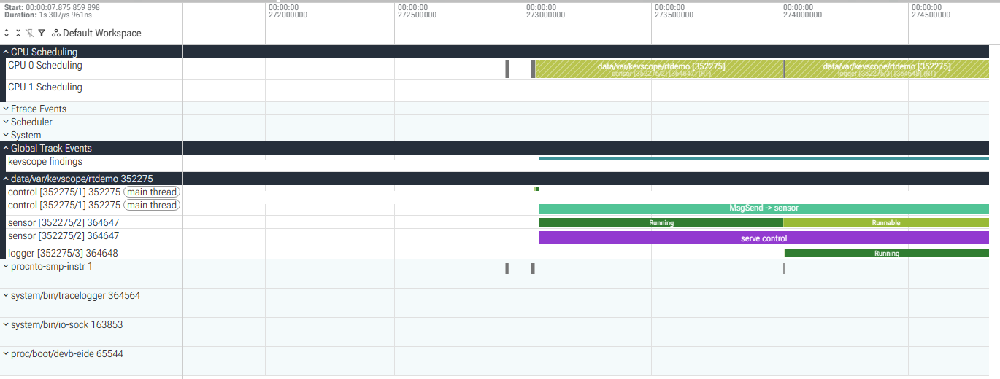
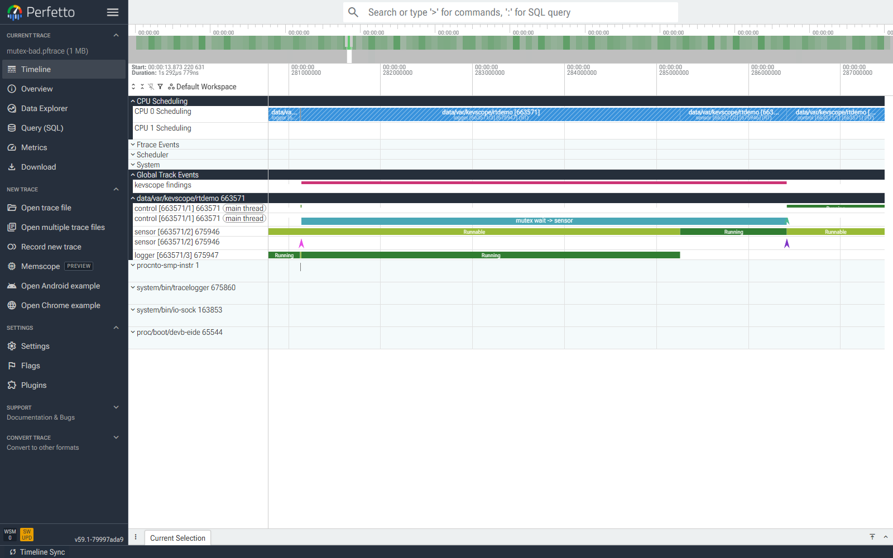
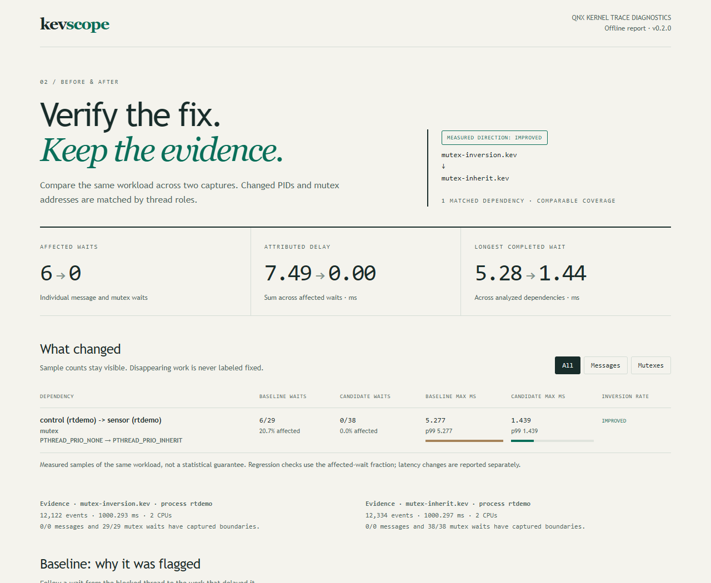

id: qnx-priority-inversion-perfetto
title: Find a Priority Inversion in a QNX Kernel Trace with Perfetto
summary: Capture a QNX 8.0 kernel trace, open it in Perfetto with kevscope, and diagnose priority inversions through messages and mutexes
categories: debugging, tools, real-time
tags: intermediate
difficulty: 3
status: published
authors: Nash Aschenbath
feedback_link: https://github.com/Aschenbath/kevscope/issues


# Find a Priority Inversion in a QNX Kernel Trace with Perfetto

## Welcome
Duration: 2:00

### Overview
A real-time thread misses its deadline, and the code looks fine. Is the CPU overloaded? Is the server too slow? Or did a lower-priority thread get in the way?

The QNX kernel can tell you. Its instrumented kernel logs every context switch, message and kernel call, and `tracelogger` saves those events to a `.kev` file. In this codelab you will:

- build a small control program for QNX 8.0 with a hidden priority-inversion bug
- run it on a QNX 8.0 virtual machine in QEMU and capture a kernel trace
- open the trace in [Perfetto](https://ui.perfetto.dev), a free web-based trace viewer, using the open-source host tool **kevscope**
- see the inversion on the timeline, and get the same answer as a command-line report
- fix the bug and prove the fix with a second trace
- repeat the diagnosis for a mutex whose priority inheritance was disabled
- compare two captures and share an offline report with exact scheduling evidence

### What you'll learn
- How QNX message passing propagates priority from client to server, and how to break it by accident
- How a mutex owner's priority changes when a more urgent thread waits for its lock
- How to capture a kernel trace with `tracelogger`
- How to read thread states (RUNNING, READY, SEND/REPLY-blocked) on a timeline

### What you'll need
- A Linux host or Windows with WSL2 (Ubuntu 22.04/24.04), with KVM available
- QNX SDP 8.0. The free [QNX Everywhere non-commercial license](https://qnx.github.io/codelabs/get-non-commercial-qnx-license/) is enough
- Python 3.9 or newer
- A web browser

No QNX hardware is needed.

To explore the finished results before installing the SDK, open the [interactive captured examples](https://aschenbath.github.io/kevscope/). Both reports are generated from the repository's controlled QNX traces and run entirely in the browser.

---

## Set Up a QNX 8.0 Virtual Machine
Duration: 10:00

If you already have a QNX 8.0 QEMU image from `mkqnximage`, skip to the next step. The [QSTI QEMU on WSL codelab](https://qnx.github.io/codelabs/qsti-qemu-on-wsl/) covers the same ground in more detail.

1. Install QEMU and give your user access to KVM:

    ```bash
    sudo apt-get install -y qemu-system-x86 qemu-utils
    sudo usermod -aG kvm "$USER"    # log out and back in afterwards
    ```

2. Load the SDP environment and build a default x86_64 image:

    ```bash
    source ~/qnx800/qnxsdp-env.sh
    mkdir -p ~/qnxvm && cd ~/qnxvm
    mkqnximage --type=qemu --arch=x86_64 --noprompt --build
    ```

    `mkqnximage` creates `output/ifs.bin` (the boot image) and `output/disk-qemu.vmdk`. It also creates a `local/snippets` folder. You'll use that folder to add your own files and startup commands.

3. Install kevscope on the host:

    ```bash
    pip install git+https://github.com/Aschenbath/kevscope
    kevscope --version
    ```

    kevscope is pure Python with no dependencies. It reads `.kev` files directly, so you don't need the SDP on the machine where you analyze traces.

---

## Meet the Demo Program
Duration: 5:00

Get the sources:

```bash
git clone https://github.com/Aschenbath/kevscope
cd kevscope/demo
```

`rtdemo.c` is a tiny control system. All of its threads are pinned to CPU 0, so they really compete:

| Thread  | Priority | What it does |
|---------|----------|--------------|
| control | 50 | Every 10 ms it sends a request to sensor with `MsgSend()`, then computes. Each cycle must finish within **5 ms**. |
| sensor  | 10 | A server. It does about 2 ms of work per request, then replies with `MsgReply()`. |
| logger  | 30 | Background work: a 6 ms burst every 25 ms. |

Sensor has the lowest priority, yet the design works on QNX. When a client sends a message, the kernel runs the server **at the client's priority** until it replies. While sensor serves control's request, it runs at 50, so logger (30) can't preempt it.

Now look at how the channel is created:

```c
sensor_chid = ChannelCreate(bad ? _NTO_CHF_FIXED_PRIORITY : 0);
```

`_NTO_CHF_FIXED_PRIORITY` tells the kernel not to change the server's priority. In `bad` mode, sensor serves control's request at priority 10, so logger can preempt it, and control stays blocked even though control is the most important thread in the system. That is a **priority inversion**.

Positive
: The flag has legitimate uses, such as a server that must never run above a certain priority. The bug is using it on a server that a real-time thread depends on. In a large system the flag can be far away from the thread that misses its deadline.

---

## Build and Capture a Kernel Trace
Duration: 10:00

The capture happens on the QNX target, inside the VM:

```bash
tracelogger -s 1 -w -b 2048 -k 64 -f /dev/shmem/bad.kev
```

| Option | Meaning |
|--------|---------|
| `-s 1` | trace for 1 second |
| `-w` | **wide mode**: includes thread names, priorities and message details. kevscope needs this |
| `-b 2048 -k 64` | more kernel buffers, so no events are dropped on a busy system |
| `-f` | output file. `/dev/shmem` is RAM, so writing it doesn't disturb the timing |

You need `tracelogger` to run while `rtdemo` is busy. `demo/capture.sh` starts `rtdemo bad 3`, waits a second, traces for one second, then repeats for `good`, `mutex-bad` and `mutex-good`. It sends each trace and the corresponding demo output to the host with a tiny TCP client (`kevpush.c`), because the default image has no working ssh server. The last two modes are used in the mutex exercise later in this codelab.

`demo/run-capture.sh` does the whole loop from the host:

1. Cross-compiles `rtdemo.c` and `kevpush.c` with `qcc -Vgcc_ntox86_64`.
2. Adds them to the image through `~/qnxvm/local/snippets/data_files.custom`, and runs `capture.sh` at boot through `post_start.custom`.
3. Rebuilds the image, starts a receiver on the host, and boots QEMU with user-mode networking (the guest reaches the host as `10.0.2.2`).

Negative
: Use a dedicated demo image. The script temporarily installs its `data_files.custom` and `post_start.custom`, restores the original snippets on exit, and leaves the generated demo boot image in place. It stops on build or transfer failure, with bounded timeouts and length-checked, acknowledged file transfers. Logs are written to the output directory. If a snippet is modified during capture, its original backup is preserved instead of overwriting the new edit.

Run it:

```bash
cd ..   # repository root
demo/run-capture.sh
```

The traces are written to the repository's `traces/` directory. Example demo output:

```
rtdemo bad: 300 cycles, 55 over the 5 ms budget, mean 3.59 ms, worst 9.24 ms
rtdemo good: 300 cycles, 0 over the 5 ms budget, mean 2.62 ms, worst 2.96 ms
rtdemo mutex-bad: 300 cycles, 12 over the 5 ms budget, mean 1.40 ms, worst 6.49 ms
rtdemo mutex-good: 300 cycles, 0 over the 5 ms budget, mean 1.29 ms, worst 2.48 ms
```

Your numbers will differ a little. In `bad` mode, about one cycle in six blows the 5 ms budget. The program knows *that* it was late, but not *why*. The trace will tell you.

---

## Open the Trace in Perfetto
Duration: 8:00

Convert the trace:

```bash
kevscope convert traces/bad.kev
```

```
wrote traces/bad.pftrace (127 KiB): 108 threads, 1269 context switches, 125 messages, 10 mutex waits, 27 priority inversions (27 message passing, 0 mutex)
```

Open [ui.perfetto.dev](https://ui.perfetto.dev), click **Open trace file**, and choose `traces/bad.pftrace`. The file is processed in your browser and isn't uploaded.

You'll see:

- **CPU Scheduling**: one lane per CPU, showing which thread ran when. CPU 0 is busy, because all `rtdemo` threads are pinned there.
- **kevscope findings** (under *Global Track Events*): one bar for each `MsgSend` that kevscope flagged as an inversion.
- One group per process. Expand `rtdemo` to see `control`, `sensor` and `logger`. Each thread has a state track (Running, Runnable, sleeping) and a slice track: `MsgSend -> sensor` on the client, `serve control` on the server.

Thread names carry the real QNX ids, e.g. `sensor [352275/2]` is pid 352275, tid 2. Perfetto shows priorities as QNX priorities, where higher means more urgent.

### Zoom into an inversion
Click a bar on the **kevscope findings** track, then press `M` to mark it and `F` to zoom to it. The details panel shows the client and server priorities, how long the client was blocked, and which threads ran instead.



Read it from top to bottom:

1. `control` enters `MsgSend -> sensor`. It is now REPLY-blocked and can't continue until sensor replies.
2. `sensor` starts `serve control` and is **Running**.
3. `logger` wakes up. CPU 0 switches to logger, and sensor becomes **Runnable**: ready to run, but preempted.
4. Control, the highest-priority thread in the program, keeps waiting while logger, a lower-priority thread, uses the CPU.

Click sensor's slice in the **CPU 0 Scheduling** lane. The details panel shows priority 10, not 50, so the server didn't inherit its client's priority.

---

## Get the Answer as a Report
Duration: 4:00

The timeline is great for understanding one case. For the whole trace, or for a CI job, use the report:

```bash
kevscope report traces/bad.kev
```

```
PRIORITY INVERSION  control (rtdemo 352275/1) (prio 50) waited on sensor (rtdemo 352275/2)
  27 of 98 messages affected. While READY, the server had priority 10, below its priority 50 client,
  so lower-priority work ran first: 91.2 ms in total, while the client was blocked 146.9 ms.
    logger (rtdemo 352275/3) (prio 30): 91.1 ms
  Worst: at +273.064 ms the client was blocked 8.22 ms, 6.07 ms of it behind lower-priority threads.
  Likely cause: the server does not inherit its client's priority. Check for a channel
  created with _NTO_CHF_FIXED_PRIORITY, or a server that sets its own priority.

Message passing (client -> server, time blocked per MsgSend):
     98  p50   2.135  p99   8.137  max   8.219 ms  control (rtdemo 352275/1) -> sensor (rtdemo 352275/2)  <- 27 inversions
```

How kevscope decides: for every `MsgSend` it finds the server thread that received and replied to the message. If the server ran below the client's priority, it then looks at the stretches where the server was READY (preempted). If threads with priority below the client's held the server's CPU during those stretches, the message counts as an inversion, and those threads are listed as the culprits.

Other useful sections of the report:
- **Message passing**: p50, p99 and max blocking time for every client → server pair
- **Mutex waits**: p50, p99 and max blocking time per waiter and lock, when wide mutex arguments are available
- **Wake-up latency**: the time from READY to RUNNING for each thread
- **CPU time** per thread

Positive
: `kevscope report trace.kev --json` prints the same data as JSON, and `--fail-on-inversion` exits with code 3 when an inversion is found. Add a trace capture to a nightly hardware or QEMU test, and the build fails the day someone adds the flag.

---

## Fix It and Prove It
Duration: 4:00

The fix is to let the kernel do its job, and create the channel without the flag:

```c
sensor_chid = ChannelCreate(0);
```

That is exactly what `rtdemo good` does, and its trace was captured in the same run:

```bash
kevscope report traces/good.kev
```

```
No priority inversion found in message passing or mutex waits.

Message passing (client -> server, time blocked per MsgSend):
     99  p50   2.043  p99   2.249  max   2.260 ms  control (rtdemo 598035/1) -> sensor (rtdemo 598035/2)
```

The worst `MsgSend` dropped from 8.2 ms to 2.3 ms in these samples. Convert the good trace with `kevscope convert traces/good.kev` and open `good.pftrace` in Perfetto. Sensor now runs at priority 50 while it serves control, so logger waits until the reply has been sent.

Logger didn't get starved by the fix. It still gets the CPU between control's requests, just never in the middle of one.

---

## Diagnose a Mutex Inversion
Duration: 6:00

The same dependency can hide behind a shared data structure. In `mutex-bad`, sensor holds a mutex while updating a reading. Control locks that same mutex to read it. The three priorities are unchanged, but the mutex is created with:

```c
pthread_mutexattr_setprotocol(&attr, PTHREAD_PRIO_NONE);
```

On QNX 8.0, this disables the default priority inheritance. Sensor stays at 10 while control (50) is MUTEX-blocked, so logger (30) can run first.

The capture script has already produced both mutex traces:

```bash
kevscope report traces/mutex-bad.kev
kevscope convert traces/mutex-bad.kev
```

The bundled failure sample reports:

```text
MUTEX PRIORITY INVERSION  control (rtdemo 663571/1) (prio 50) waited for a mutex held by sensor (rtdemo 663571/2)
  6 of 29 waits affected. While READY, the owner had priority 10, below its priority 50 waiter,
  so lower-priority work ran first: 7.5 ms in total, while the waiter was blocked 11.2 ms.
    logger (rtdemo 663571/3) (prio 30): 7.5 ms
  Worst: at +281.141 ms the waiter was blocked 5.28 ms, 4.12 ms of it behind lower-priority threads.
  Mutex 0x4c5ad45018, protocol PTHREAD_PRIO_NONE.
```

Open `mutex-bad.pftrace` in Perfetto, expand the findings and `rtdemo` tracks, and focus on a `mutex priority inversion` finding. Control's `mutex wait -> sensor` slice spans the wait. Sensor is Runnable while logger is Running, then sensor resumes and releases the lock:



The model gets the lock address, protocol flags and owner word from the wide `SyncMutexLock` event. MUTEX state transitions bound the wait. Owner READY intervals and the threads running on its CPU provide the scheduling evidence. The protocol alone is not enough to flag an inversion.

### Enable inheritance and compare

Remove the `pthread_mutexattr_setprotocol(..., PTHREAD_PRIO_NONE)` call, leaving QNX's default `PTHREAD_PRIO_INHERIT`. This is `mutex-good`:

```bash
kevscope report traces/mutex-good.kev --fail-on-inversion
kevscope convert traces/mutex-good.kev
```

The bundled fixed trace has 38 control waits, no detected inversion, and a worst mutex wait of 1.439 ms instead of 5.277 ms. Sensor runs at priority 50 while control waits. The three-second demo reports zero cycles over budget instead of 12; the one-second trace covers only part of that run.

`--fail-on-inversion` returns 3 for the failure trace and 0 for the fixed trace, just as it does for message passing. JSON uses `mutex_priority_inversion` for these findings and includes the mutex address and protocol. The original message-passing finding kind remains `priority_inversion`.

This exercise uses same-process mutexes and one CPU. Cross-process shared-memory lock identity, general condition-variable dependencies, and full SMP scheduler/affinity analysis remain outside the validated cases. Missing owner events or truncated waits can prevent a finding.

---

## Compare Captures and Share the Evidence
Duration: 4:00

A fix should be checked against the same workload. Compare the mutex captures and save a report that can be opened without Perfetto or a QNX installation:

```bash
kevscope compare traces/mutex-bad.kev traces/mutex-good.kev --process rtdemo --html comparison.html
```

Open `comparison.html` in a browser. The bundled example shows 6/29 affected waits becoming 0/38, with maximum mutex wait dropping from 5.277 to 1.439 ms. The protocol change remains visible next to the measurements. Counts and timing will vary in a fresh run.



Expand the baseline finding, then select **Inspect exact intervals and priorities**. Each row identifies the CPU and the three priorities at the same instant: owner ≤ running thread < waiter. A boost later in the wait does not erase an earlier inversion. If the executions surrounding a READY interval use different CPUs, kevscope excludes it and reports the missing migration evidence.

`--process rtdemo` scopes the waits and summary statistics to the application. Other processes remain available as scheduling evidence. This avoids confusing an unrelated background condition-variable wait with missing application data.

For a single trace, use:

```bash
kevscope report traces/bad.kev --process rtdemo --html report.html
```

The reports work offline, include no generation timestamp, and escape trace-derived text. Review the report before sharing traces from your own system: thread names and measured scheduling behavior are still part of its contents.

### Automate the comparison

```bash
kevscope compare traces/mutex-bad.kev traces/mutex-good.kev --process rtdemo --json --strict --fail-on-regression
```

The comparison pairs process basenames and thread names rather than PIDs or virtual addresses. It refuses ambiguous matches and labels disappearing work **not observed**, not fixed. Regression checks compare the fraction of affected waits rather than the raw count; p99 and maximum latency changes are shown separately.

`--fail-on-regression` exits 3 for a higher affected-wait fraction or a new dependency with a finding. `--strict` exits 4 if there are evidence warnings or incomplete matches, taking precedence over 3. Input/output failures exit 1 and argument errors exit 2. Unfinished waits at the capture boundary are counted and excluded from full-wait statistics.

No detected inversion does not guarantee every deadline was met. The trace spans only part of the program's run, and CPU load, other blocking, interrupts or virtualization can affect cycle timing independently of priority inheritance.

---

## Congratulations
Duration: 1:00

You captured kernel traces on QNX 8.0, viewed them in Perfetto, and confirmed fixes for priority inversions through both message passing and a mutex.

### What you've learned
- QNX servers inherit their client's priority while serving a message, unless the channel uses `_NTO_CHF_FIXED_PRIORITY`
- QNX mutexes default to `PTHREAD_PRIO_INHERIT`; disabling it can leave a high-priority waiter blocked behind lower-priority work
- How to capture a trace with `tracelogger -w`
- How to read thread states, message-passing slices and mutex waits in Perfetto
- How to use `kevscope report` to check a whole trace, by hand or in CI
- How to compare captures, interpret coverage warnings, and share exact evidence in an offline report

### Try next
- Trace your own application in wide mode and check the supported trace formats and analysis limits in the kevscope README
- Use Perfetto's **Query (SQL)** page. For example, `select * from sched where dur > 1e6` lists every slice of more than 1 ms on a CPU
- Read about [message passing and priority inheritance](https://www.qnx.com/developers/docs/8.0/com.qnx.doc.neutrino.sys_arch/topic/ipc_Priority_inheritance_messages.html) in the QNX System Architecture guide

### Learn more
- [kevscope on GitHub](https://github.com/Aschenbath/kevscope)
- [tracelogger reference](https://www.qnx.com/developers/docs/8.0/com.qnx.doc.neutrino.utilities/topic/t/tracelogger.html)
- [Perfetto documentation](https://perfetto.dev/docs/)
