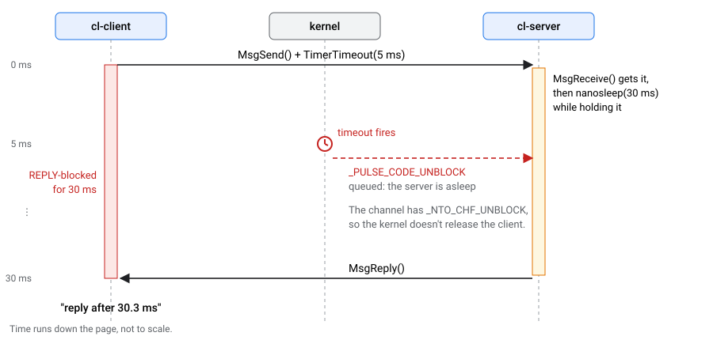
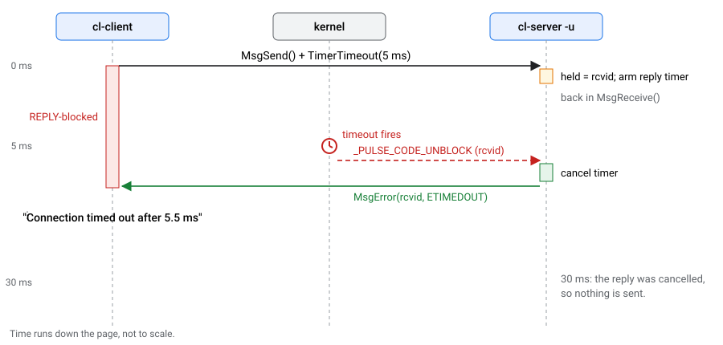
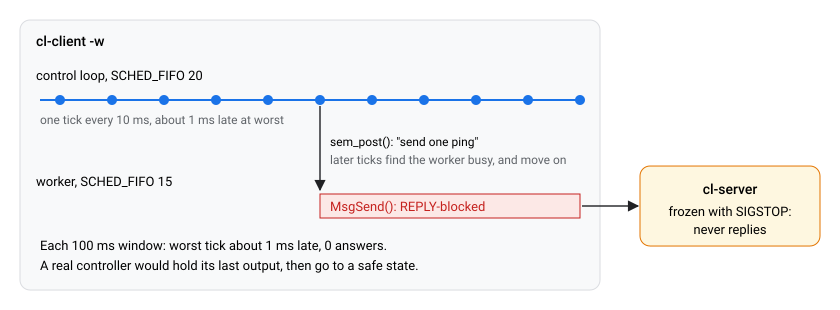

id: qnx-timertimeout-unblock
title: Why Your QNX TimerTimeout Doesn't Time Out
summary: Watch a 5 ms TimerTimeout fail to free a REPLY-blocked client, learn what _NTO_CHF_UNBLOCK does, then fix it yourself: deferred replies in the server, and a worker thread in the client.
categories: qnx, message-passing, real-time
tags: intermediate
difficulty: 2
status: published
authors: Zuhair Halawa
feedback_link: https://github.com/qnx/codelabs/issues


# Why Your QNX TimerTimeout Doesn't Time Out

## Introduction
Duration: 3:00

### Overview
A client sends a request with a 5 ms timeout. The server takes 30 ms. How long does the client wait?

On QNX, the answer is often **30 ms**. And if the server freezes, the client may wait forever, even through `SIGKILL`.

In this codelab you will build a tiny message-passing server and client and watch that happen on a real QNX 8.0 target. Then you will fix it twice: you write the server-side fix yourself, and you see how a control loop protects itself from a server that can't answer at all.

This behaviour was found by [Faultline](https://github.com/zuhairhalawa/faultline), a fault-injection tool for QNX 8.0: a 100 Hz pump controller that read its sensor with a 5 ms timeout ran 77 ms late when the sensor froze.

### What you'll be able to do
* Explain what `_NTO_CHF_UNBLOCK` does, and why every `name_attach()` server has it.
* Predict when `TimerTimeout()` will release a client, and when it can't.
* Write a server that keeps slow requests as **deferred replies** and answers `_PULSE_CODE_UNBLOCK`.
* Structure a periodic loop so a frozen server can't make it miss deadlines.

### Prerequisites
* **QNX SDP 8.0** on Linux or WSL2, with `qcc` working (`source ~/qnx800/qnxsdp-env.sh`). See [Get a Free Non-Commercial QNX 8.0 License](https://qnx.github.io/codelabs/get-non-commercial-qnx-license/).
* **A QNX 8.0 target you can reach with SSH as root**, for example a QEMU image from `mkqnximage --type=qemu`. Every output in this codelab comes from QNX 8.0 x86_64 in QEMU with KVM; your timings will differ a little.
* Comfort with C. No prior QNX message-passing experience is needed.

aside positive
Throughout this codelab you'll see **Predict** boxes. Commit to an answer before you run the command. Guessing wrong, then seeing why, is how this sticks.

---

## Build and copy to the target
Duration: 5:00

1. **Get the code.** It's in the `codelab` folder of the Faultline repository:
    ```bash
    git clone https://github.com/zuhairhalawa/faultline.git
    cd faultline/codelab
    ```
2. **Build with the QNX toolchain:**
    ```bash
    source ~/qnx800/qnxsdp-env.sh
    make
    ```
    This builds three programs into `build/x86_64/`. For a Raspberry Pi, run `make PLATFORM=aarch64le` and use `build/aarch64le/` below.
3. **Copy them to the target:**
    ```bash
    ssh root@<target-ip> mkdir -p /data/cl
    scp build/x86_64/cl-* root@<target-ip>:/data/cl/
    ```
4. **Log in to the target** and go to the folder:
    ```bash
    ssh root@<target-ip>
    cd /data/cl
    ```

### The programs
* `cl-client [-t TIMEOUT_MS] [-n COUNT] [-w]` sends a ping every 100 ms. Each `MsgSend()` is bounded by `TimerTimeout()` (5 ms by default) for both the SEND and REPLY states. `-w` is the control loop from step 7.
* `cl-server [-d DELAY_MS] [-u]` registers the name `cl-ping` with `name_attach()` and answers pings. `-d` makes every answer late. `-u` turns on the fix.
* `cl-server-todo` is the same server with the fix left out. You complete it in step 6.

Each step runs the server in the background (`&`) and the client in the same shell, so you can signal both. `$!` holds the pid of the last background process; the steps save it in `SP` (server) and `CP` (client). The `sleep 1` after starting a server gives it time to start and register its name before the next command signals it or connects to it. Between steps, stop everything with:
```bash
slay -s SIGCONT cl-server cl-server-todo 2>/dev/null; slay -s SIGKILL cl-server cl-server-todo cl-client 2>/dev/null
```

---

## A healthy server
Duration: 3:00

```bash
./cl-server & SP=$!; sleep 1
./cl-client -n 3
```

```console
server: pid 11907101, name cl-ping, delay 0 ms, naive (sleeps, then replies)
client: pid 11919390, timeout 5 ms
ping  1: reply after 0.0 ms
ping  2: reply after 0.0 ms
ping  3: reply after 0.1 ms
```

### What just happened
QNX message passing is synchronous. One ping goes through three states:

1. The client calls `MsgSend()`. Until the server receives the message, the client is **SEND-blocked**.
2. The server's `MsgReceive()` returns the message and an `rcvid` that identifies this client. Now the client is **REPLY-blocked**: it waits until the server answers that `rcvid`.
3. The server calls `MsgReply(rcvid, ...)`. The kernel copies the answer into the client's buffer, and the client runs again.

`TimerTimeout()` asks the kernel to stop waiting after 5 ms, in either blocked state. Keep those two states in mind; the rest of the codelab is about the second one.

---

## A slow server ignores your timeout
Duration: 6:00

Now the server answers 30 ms late. The client still sets a 5 ms timeout on every `MsgSend()`.

aside positive
**Predict:** what will `ping 1` print? (a) `Connection timed out after ~5 ms`, (b) `reply after ~30 ms`, (c) nothing, it hangs.

```bash
./cl-server -d 30 & SP=$!; sleep 1
./cl-client -n 3
```

```console
server: pid 11956253, name cl-ping, delay 30 ms, naive (sleeps, then replies)
client: pid 11968542, timeout 5 ms
server: got _PULSE_CODE_UNBLOCK (ignored; already replied)
ping  1: reply after 30.3 ms
server: got _PULSE_CODE_UNBLOCK (ignored; already replied)
ping  2: reply after 31.2 ms
server: got _PULSE_CODE_UNBLOCK (ignored; already replied)
ping  3: reply after 31.3 ms
```

The answer is **(b)**. The timeout fired at 5 ms, yet every call took 30 ms, and the server received one `_PULSE_CODE_UNBLOCK` per ping.



### Why
1. `name_attach()` creates its channel with `_NTO_CHF_UNBLOCK` (along with `_NTO_CHF_DISCONNECT` and `_NTO_CHF_COID_DISCONNECT`). See [`name_attach()`](https://www.qnx.com/developers/docs/8.0/com.qnx.doc.neutrino.lib_ref/topic/n/name_attach.html) and [`ChannelCreate()`](https://www.qnx.com/developers/docs/8.0/com.qnx.doc.neutrino.lib_ref/topic/c/channelcreate.html).
2. On such a channel, when a **REPLY-blocked** client wants to stop waiting (its timeout fires, or it gets a signal), the kernel doesn't release it. It sends the server a `_PULSE_CODE_UNBLOCK` pulse and leaves the client REPLY-blocked until the server replies or calls `MsgError()`.
3. This server sleeps while it holds the request, so the pulse waits in its queue until after it has replied. Too late to matter.

The flag exists for a good reason: a server may have work in flight for that client, such as a DMA transfer or a reply buffer, and must clean it up before the client goes away. But it means **the server decides when your timeout takes effect.**

---

## A frozen server holds you forever
Duration: 6:00

Freeze the server with `SIGSTOP` before the client even starts.

aside positive
**Predict:** the server is stopped before the client sends anything. Will the client be SEND-blocked (where its timeout works) or REPLY-blocked?

```bash
./cl-server & SP=$!; sleep 1
kill -STOP $SP
./cl-client -n 1 & CP=$!
sleep 1
pidin -p cl-client -F "%a %b %N %p %J %B"
```

```console
     pid tid name               prio STATE          Blocked
12017694   1 cl-client           10r REPLY          12005405
```

**REPLY**, on the server's pid. The server's thread was already waiting in `MsgReceive()` when it was stopped, and the kernel still handed it the message. So the client is past the point where its timeout could have saved it. (If you run `pidin` straight away, you may briefly catch the client REPLY-blocked on pid 1 while `name_open()` finishes; that's why the step waits a second.)

### Try to get the client out
These are alternatives. After each one, clean up and repeat the commands above.

aside positive
**Predict:** which of these four frees the client?

* `kill -TERM $CP`: nothing happens. `pidin` still shows the client in `REPLY`.
* `kill -KILL $CP`: nothing happens either. On QNX 8.0 in our runs, `pidin` still showed the client REPLY-blocked after `SIGKILL`.
* `kill -CONT $SP`: the server runs, answers the pending request, and only then can the client finish or act on a signal you sent it.
* `kill -KILL $SP`: the client is freed with an error:
    ```console
    ping  1: No such process after 1005.9 ms
    ```
    The request in flight fails with `ESRCH`. Any later `MsgSend()` on the same connection fails at once with `EBADF`, because the connection is gone.

aside negative
A frozen server can hold its clients through a timeout, `SIGTERM` and even `SIGKILL`. Only resuming or killing the server releases them.

---

## Your turn: fix the server
Duration: 12:00

A server that can be slow must never sleep while it holds a request. Instead:

1. **Keep the request as a deferred reply.** Save the `rcvid` and go straight back to `MsgReceive()`. Nothing forces a server to reply before it receives the next message.
2. **Reply later, from a timer.** A one-shot timer sends the server a pulse when the answer is due.
3. **Answer the unblock pulse.** If `_PULSE_CODE_UNBLOCK` arrives for the held `rcvid` first, cancel the timer and release the client with `MsgError()`.



### The exercise
Open `server-todo.c` on your host. It's the whole server, with two gaps marked `TODO 1` and `TODO 2`. Everything else is in place: the timer `reply_timer` is created at startup with `SIGEV_PULSE_INIT` aimed at the server's own channel, so its `PULSE_REPLY_DUE` pulse arrives through the same `MsgReceive()` as everything else, and that case already sends the held reply.

* **TODO 2**, in the request path: stop sleeping. Keep the request so you can answer it later, and make `reply_timer` fire once, `delay_ms` from now.
* **TODO 1**, in the `_PULSE_CODE_UNBLOCK` case: the client you're holding wants to leave. Release it with an error it will recognise as a timeout, and make sure your scheduled reply never goes out.

Do TODO 2 first. After each TODO, rebuild with `make`, copy `cl-server-todo` to the target, and run:
```bash
./cl-server-todo -d 30 -u & SP=$!; sleep 1
./cl-client -n 3
```

### What you should see at each stage
**Neither TODO done.** Still the naive server:
```console
ping  1: reply after 32.6 ms
```

**Only TODO 2 done.** The server now holds the request and sees the unblock pulse for it (that `printf` is already in the TODO 1 branch), but nothing releases the client yet, so it still waits for the timer's reply:
```console
server: client gave up waiting (TODO 1 decides what happens next)
ping  1: reply after 31.8 ms
```

**Both done.** The client's timeout works (the server's line is whatever you print in TODO 1):
```console
ping  1: Connection timed out after 5.4 ms
ping  2: Connection timed out after 6.1 ms
```

It fires a little after 5 ms because timers expire on the system clock tick, 1 ms by default. Finally, check that a reply that is late but still inside the timeout is delivered normally:
```bash
./cl-server-todo -d 3 -u & SP=$!; sleep 1
./cl-client -n 3
```

```console
ping  1: reply after 3.7 ms
ping  2: reply after 4.1 ms
ping  3: reply after 4.3 ms
```

### Hints
Try without them first. Each one gives away a little more.

* **Hint 1 (TODO 2):** the server already has two variables for this, `held` and `held_reply`, and the `PULSE_REPLY_DUE` case reads them. A one-shot timer is a `struct itimerspec` with only `it_value` set.
* **Hint 2 (TODO 1):** which call lets a server answer a client with an error instead of data? And how do you disarm a timer you already armed?
* **Hint 3, the code:** TODO 2 is `held = rcvid; held_reply = r;`, then `struct itimerspec its = { 0 };` with `its.it_value.tv_sec = delay_ms / 1000;` and `its.it_value.tv_nsec = (delay_ms % 1000) * 1000000L;`, then `timer_settime(reply_timer, 0, &its, NULL);`. TODO 1 is `timer_settime(reply_timer, 0, &off, NULL); MsgError(held, ETIMEDOUT); held = 0;`.
* **Solution:** the finished server is [`server.c`](https://github.com/zuhairhalawa/faultline/blob/master/codelab/server.c). It's `cl-server -u`.

aside positive
On a `name_attach()` channel, a client that timed out and a client that got a signal both arrive as the same `_PULSE_CODE_UNBLOCK`. This codelab answers `ETIMEDOUT` because its client uses timeouts; a server whose clients are interrupted by signals would usually answer `EINTR`. (The QNX 8.0 headers also define `_NTO_CHF_UNBLOCK_TIMER` and `_PULSE_CODE_UNBLOCK_TIMER` for channels you create yourself with `ChannelCreate()`; they aren't covered here.)

---

## Protect the client with a worker thread
Duration: 6:00

The fixed server only helps while it can run. Freeze it and the client is stuck exactly as in step 5: nobody is left to answer the unblock pulse.

So a client with a deadline shouldn't call `MsgSend()` from its time-critical thread, at least not to a server it can't trust to answer. In `cl-client -w`, a 100 Hz loop at `SCHED_FIFO` priority 20 hands each request to a worker thread at priority 15 and never waits for it. It uses whatever answers have arrived, and keeps time either way:
```c
clock_nanosleep(CLOCK_MONOTONIC, TIMER_ABSTIME, &next, NULL);
/* ... measure how late this tick is ... */
int idle = 0;                                        /* never wait for the server here */
if (atomic_compare_exchange_strong(&busy, &idle, 1)) sem_post(&go);
```



First, with a healthy server:
```bash
./cl-server > /dev/null & SP=$!; sleep 1
./cl-client -w -n 3
```

```console
loop: 100 ms window  1, worst tick 1.03 ms late, 9 answers
loop: 100 ms window  2, worst tick 0.94 ms late, 10 answers
loop: 100 ms window  3, worst tick 0.93 ms late, 10 answers
```

About 1 ms of lateness is the clock tick again: an absolute sleep wakes on the next tick.

aside positive
**Predict:** freeze the server 150 ms into the run. What happens to the worst tick, and to the answers?

```bash
./cl-server > /dev/null & SP=$!; sleep 1
./cl-client -w -n 5 & CP=$!
sleep 0.15; kill -STOP $SP
```

```console
loop: 100 ms window  1, worst tick 1.13 ms late, 9 answers
loop: 100 ms window  2, worst tick 0.98 ms late, 6 answers
loop: 100 ms window  3, worst tick 1.01 ms late, 0 answers
loop: 100 ms window  4, worst tick 1.05 ms late, 0 answers
loop: 100 ms window  5, worst tick 1.10 ms late, 0 answers
```

The answers stop, but the loop stays on time. In a real controller, "0 answers" is what your fault handling reacts to: hold the last value, then go to a safe state.

### The client still can't exit
When the loop finishes, look at the client again:
```bash
pidin -p cl-client -F "%a %b %N %p %J %B"
```

```console
     pid tid name               prio STATE          Blocked
12304414   2 cl-client           15f REPLY          12292125
```

Look at the server too, with `pidin -p cl-server -F "%a %b %N %p %J %B"`:

```console
     pid tid name               prio STATE          Blocked
17481757   1 cl-server           15r STOPPED
```

It started at the default priority 10, but it shows 15: when its thread received the worker's message, QNX gave it the sender's priority. That's priority inheritance through message passing, and here the server is stuck at the borrowed priority.

The worker thread (tid 2, priority 15 FIFO) is still REPLY-blocked on the frozen server, and as in step 5, even `SIGKILL` doesn't free it. What does free it is dealing with the server: resume it, or kill it. That's the job of a supervisor that watches heartbeats and kills a server that stops sending them. [Faultline](https://github.com/zuhairhalawa/faultline) does exactly that with its `fl-supervisor`.

---

## Common mistakes
Duration: 3:00

* **Sleeping, or blocking on anything slow, while holding a request.** The unblock pulse then waits behind your work, as in step 4. Defer the reply instead.
* **Reading the rcvid from `sival_int`.** `rcvid_t` is 64-bit on QNX 8.0, so compare with `(rcvid_t)msg.pulse.value.sival_long`.
* **Initialising `struct itimerspec` by position.** POSIX doesn't fix the order of its members. The first version of this codelab's server wrote `{ { 0, 0 }, { sec, nsec } }`, meaning interval then value; on QNX 8.0 that left `it_value` at zero, which disarms the timer, so no held reply was ever sent. Set `its.it_value.tv_sec` and `.tv_nsec` by name.
* **Trusting a timeout in a control loop.** It only works if the server answers the unblock pulse. Keep `MsgSend()` out of the time-critical thread.
* **Trying to unstick a client by killing it.** A client REPLY-blocked on a frozen `_NTO_CHF_UNBLOCK` server survived `SIGKILL` in our runs. Deal with the server.

---

## Check your understanding
Duration: 4:00

Answer these without scrolling back. The answers are below.

1. A client's `MsgSend()` has a 5 ms `TimerTimeout()` for SEND and REPLY. The single-threaded `name_attach()` server receives the message at once, then sleeps 20 ms before replying. How long does the client wait?
2. Same server, but it uses deferred replies and answers `_PULSE_CODE_UNBLOCK` with `MsgError(rcvid, ETIMEDOUT)`. How long now, and what does `MsgSend()` return?
3. Why doesn't the kernel just release the client when the timeout fires?
4. A worker thread is REPLY-blocked on a frozen server. Name two things that release it, and one that doesn't.
5. Your 100 Hz loop must never be more than 2 ms late, and it needs readings from a server that might freeze. Where should the `MsgSend()` happen?

### Answers
1. About **20 ms**. The client is REPLY-blocked, so the kernel only notifies the server with `_PULSE_CODE_UNBLOCK`, and this server's only thread is asleep until it has replied.
2. About **5 ms** (a little more, on the clock tick). `MsgSend()` returns -1 with `errno` set to `ETIMEDOUT`.
3. Because the channel has `_NTO_CHF_UNBLOCK`, which every `name_attach()` channel gets. That flag tells the kernel to hand the decision to the server, which may need to clean up work in flight for that client first.
4. Killing the server releases it at once (with `ESRCH`). Resuming the server releases it as soon as the server replies or answers the unblock pulse. Killing the client, even with `SIGKILL`, didn't in our runs.
5. In a lower-priority worker thread. The loop only kicks the worker and uses whatever fresh data has arrived, so a frozen server costs it data, not deadlines.

---

## Recap and clean up
Duration: 2:00

### What you learned
* Every `name_attach()` channel has `_NTO_CHF_UNBLOCK`. Once the server has your message, **your `TimerTimeout()` only works if the server answers the unblock pulse.**
* **In servers:** never sleep or block while holding a request. Use deferred replies, and answer `_PULSE_CODE_UNBLOCK` with `MsgError()`.
* **In clients with deadlines:** do the `MsgSend()` from a lower-priority worker thread, and decide from fresh data, not from whether the call returned.
* **In the system:** a frozen server can't release anyone, not even a client being killed. Detect it with heartbeats and kill it. That fails the request in flight with `ESRCH`, and the client can reconnect to a restarted server.

### Clean up
```bash
slay -s SIGCONT cl-server cl-server-todo 2>/dev/null; slay -s SIGKILL cl-server cl-server-todo cl-client 2>/dev/null
rm -rf /data/cl
```

### Learn more
* [`ChannelCreate()`](https://www.qnx.com/developers/docs/8.0/com.qnx.doc.neutrino.lib_ref/topic/c/channelcreate.html): the channel flags, including `_NTO_CHF_UNBLOCK`.
* [`TimerTimeout()`](https://www.qnx.com/developers/docs/8.0/com.qnx.doc.neutrino.lib_ref/topic/t/timertimeout.html): kernel timeouts for blocking states.
* [`MsgError()`](https://www.qnx.com/developers/docs/8.0/com.qnx.doc.neutrino.lib_ref/topic/m/msgerror.html): releasing a client with an error.
* [Faultline](https://github.com/zuhairhalawa/faultline): the fault-injection lab where this behaviour was found.
