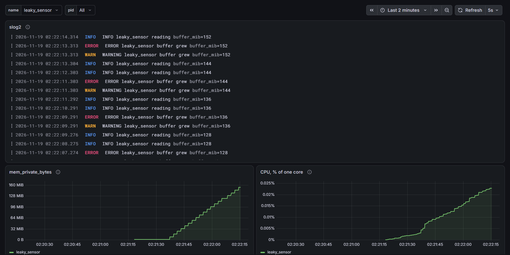

id: ship-qnx-logs-fluent-bit
title: Ship QNX logs to a dashboard with Fluent Bit
summary: Build Fluent Bit for QNX 8.0, read the QNX system log and per-process memory with it, and watch a leaking program on a Grafana dashboard.
categories: Porting & Open Source
tags: intermediate
platforms: QEMU, Windows (WSL)
published: 2026-11-19
featured: false
status: published
authors: Jake Hoffman
feedback_link: https://github.com/jakethehoffer/fluent-bit-qnx/issues

# Ship QNX logs to a dashboard with Fluent Bit

## Welcome
Duration: 2:00

A QNX device in a car or a factory writes its logs to **slog2**, the QNX system logger. That's fine while you're sitting next to it with `slog2info`. Once there are a hundred devices in the field, you want their logs and their health in one place.

On Linux, that job usually goes to [Fluent Bit](https://fluentbit.io/), a small CNCF agent that reads local logs and ships them somewhere else. In this codelab you'll use [`fluent-bit-qnx`](https://github.com/jakethehoffer/fluent-bit-qnx), a port of Fluent Bit 5.2.0 to QNX 8.0 with two inputs written for QNX, and run it on QNX 8.0 under QEMU.

### What you'll build

* A small C program that logs to slog2.
* A Fluent Bit setup on QNX that reads those log lines live, plus the memory and CPU time of the processes you choose.
* A pipeline from QNX to Loki and Grafana on your machine, where you watch a program leak memory.
* A low-priority agent that keeps records on disk while the dashboard is down and sends them when it's back.

### What you'll learn

* How to cross-build Fluent Bit for QNX 8.0 and run it on a target
* How the `slog2` input reads the QNX system log
* How the `qnx_proc` input reports per-process memory and CPU time
* How to ship records off the device with the Loki output
* How to run a log agent so it never gets ahead of the device's real work

You need basic shell and C. No QNX experience is assumed.

---

## Before you begin
Duration: 10:00

You need a Linux x86_64 machine with KVM. Ubuntu 24.04 under WSL2 on Windows 11 works, and it's what this codelab was tested on.

### A QNX license and the SDP

1. Follow QNX's codelab [Get a non-commercial QNX license](https://qnx.github.io/codelabs/get-non-commercial-qnx-license/) to get your free license.
2. In QNX Software Center, install **QNX SDP 8.0** into `~/qnx800`.

### Host tools

Install the build tools and QEMU, and let yourself use KVM:

```sh
sudo apt install git cmake ninja-build qemu-system-x86 qemu-utils python3 curl patch openssh-client
sudo usermod -aG kvm $USER
```

Log out and back in (for WSL, run `wsl --shutdown` from Windows) so the group change takes effect.

### About the QNX target

QNX's own QEMU codelabs ([on Ubuntu](https://qnx.github.io/codelabs/setup-qsti-qemu-on-ubuntu/), [on WSL](https://qnx.github.io/codelabs/qsti-qemu-on-wsl/)) boot QNX's Quick Start Target Image. You don't need that image here. The repository you'll clone has a script that builds a small QNX 8.0 image from your own SDP and boots it headless, with SSH on port 2222.

_When you're ready, continue._

---

## Build Fluent Bit for QNX
Duration: 15:00

1. Clone the port and go into it:

    ```sh
    git clone https://github.com/jakethehoffer/fluent-bit-qnx.git
    cd fluent-bit-qnx
    ```

    The repository holds no Fluent Bit source. It pins the Fluent Bit 5.2.0 release tarball by its SHA-256, and keeps the QNX changes as a numbered patch series in `patches/` and the two QNX inputs in `plugins/`.

2. Load the build environment. This sources the QNX SDP and sets the paths the tools use, such as `$FBQ_TARGET_DIR`, the install folder on the target:

    ```sh
    source tools/env.sh
    ```

    Do this in every new terminal you use for this codelab.

3. Build:

    ```sh
    tools/build.sh
    ```

    The script downloads the tarball (once), checks its SHA-256, applies the patches, copies in the QNX inputs and cross-builds with the SDP's `qcc` through CMake and Ninja. The first build takes several minutes. It ends with the path of the QNX binary:

    ```text
    build ok: /home/you/build/fluent-bit-qnx/bin/fluent-bit
    ```

4. Start the QNX target and copy Fluent Bit to it:

    ```sh
    tools/qemu-up.sh
    tools/deploy.sh
    ```

    The first `qemu-up.sh` builds the image with QNX's `mkqnximage`. Later runs reuse it. `deploy.sh` copies the binary to `$FBQ_TARGET_DIR/bin`, along with three small helper programs the repository's own tests use, then runs `fluent-bit --version` on QNX to prove it starts:

    ```text
    QNX target up: ssh -i /home/you/.ssh/qnx_target_ed25519 -p 2222 root@127.0.0.1
    deployed helper memhog
    deployed helper spinner
    deployed helper slog2_emit
    Fluent Bit v5.2.0
    /data/fluent-bit-qnx/bin/fluent-bit
    ```

Positive
: The target keeps running in the background. You'll stop it with `tools/qemu-down.sh` at the end.

---

## Open a shell on QNX
Duration: 2:00

You'll use two terminals from here on. The first stays on your machine, in the `fluent-bit-qnx` folder. The second is a shell on QNX.

1. Open a second terminal, go to the same folder and load the environment there too:

    ```sh
    cd fluent-bit-qnx
    source tools/env.sh
    ```

2. Log in to the target. `-t` gives you a real terminal, so Ctrl+C reaches programs on QNX:

    ```sh
    ssh $FBQ_SSH_OPTS -t root@127.0.0.1
    ```

3. On QNX, go to the install folder and check that Fluent Bit runs there:

    ```shell
    cd /data/fluent-bit-qnx
    uname -a
    LD_LIBRARY_PATH=lib bin/fluent-bit --version
    ```

    `lib` is where `deploy.sh` puts any SDP library the target image lacks ([`qnx/target-libs.txt`](https://github.com/jakethehoffer/fluent-bit-qnx/blob/main/qnx/target-libs.txt) lists them). This image has every library Fluent Bit needs, so `lib` is empty, but keeping `LD_LIBRARY_PATH` makes the same commands work on an image that needs one:

    ```text
    QNX qnx-ipc 8.0.0 2026/06/05-16:26:03EDT x86pc x86_64
    Fluent Bit v5.2.0
    Git commit:
    ```

From now on, a `shell` block runs in this QNX terminal and an `sh` block runs in the first terminal on your machine.

---

## Log from a QNX program
Duration: 8:00

QNX programs don't write their logs to a file. They register a **buffer set** with slog2 and write log lines into it, each with a severity. The system logger keeps those lines in memory, and tools read them from there. Start with a program that logs.

1. In your first terminal, make a folder for your own files:

    ```sh
    mkdir -p my
    ```

2. Create `my/hello_slog.c` with this content:

    ```c
    #include <stdio.h>
    #include <string.h>
    #include <unistd.h>
    #include <sys/slog2.h>

    int main(void)
    {
        slog2_buffer_set_config_t cfg;
        slog2_buffer_t buffer;
        int n;

        /* One buffer set called hello_slog, with one 4-page buffer. */
        memset(&cfg, 0, sizeof(cfg));
        cfg.buffer_set_name = "hello_slog";
        cfg.num_buffers = 1;
        cfg.verbosity_level = SLOG2_INFO;
        cfg.buffer_config[0].buffer_name = "main";
        cfg.buffer_config[0].num_pages = 4;
        if (slog2_register(&cfg, &buffer, 0) != 0) {
            fprintf(stderr, "slog2_register failed\n");
            return 1;
        }

        for (n = 1; ; n++) {
            slog2f(buffer, 0, SLOG2_INFO, "temperature reading %d: 41 C", n);
            if (n % 5 == 0) {
                slog2c(buffer, 0, SLOG2_WARNING, "fan is running hot");
            }
            sleep(1);
        }
    }
    ```

    `slog2_register` creates the buffer set. `slog2f` logs a formatted line and `slog2c` a fixed one. The `0` before the severity is a code you can use to tag lines. A line with a severity above `verbosity_level` (less important) is dropped.

3. Cross-compile it for QNX and copy it to the target:

    ```sh
    qcc -Vgcc_ntox86_64 -Wall -o my/hello_slog my/hello_slog.c -lslog2
    fbq_scp my/hello_slog $FBQ_TARGET_DIR/bin/
    ```

4. In the QNX terminal, start it in the background and read its buffer set with `slog2info`:

    ```shell
    bin/hello_slog &
    sleep 6
    slog2info -b hello_slog
    ```

    You'll see its lines, each with the time, the buffer set and process id, the buffer, the code and the text. `slog2info` leaves the severity out by default, but it's stored with every line:

    ```text
    Nov 19 07:26:26.107              hello_slog.643093                 main*     0  temperature reading 1: 41 C
    Nov 19 07:26:27.107              hello_slog.643093                 main      0  temperature reading 2: 41 C
    Nov 19 07:26:28.109              hello_slog.643093                 main      0  temperature reading 3: 41 C
    Nov 19 07:26:29.109              hello_slog.643093                 main      0  temperature reading 4: 41 C
    Nov 19 07:26:30.110              hello_slog.643093                 main      0  temperature reading 5: 41 C
    Nov 19 07:26:30.110              hello_slog.643093                 main      0  fan is running hot
    Nov 19 07:26:31.111              hello_slog.643093                 main      0  temperature reading 6: 41 C
    Nov 19 07:26:32.112              hello_slog.643093                 main      0  temperature reading 7: 41 C
    ```

Leave `hello_slog` running.

---

## Read the system log with Fluent Bit
Duration: 8:00

Fluent Bit works as a pipeline: **inputs** make records, and **outputs** send them somewhere. The `slog2` input reads the system log live, the way `slog2info -w` does, and turns each line into a record.

1. In your first terminal, create `my/slog.conf`:

    ```ini
    [SERVICE]
        Flush      1
        Log_Level  warn

    [INPUT]
        Name   slog2
        Tag    slog
        match  hello_slog

    [OUTPUT]
        Name    stdout
        Match   *
        Format  json_lines
    ```

    `match` keeps only the `hello_slog` buffer set. Leave it out to read every buffer set on the system. By default the input starts from now and skips older lines (`from_now true`).

2. Copy it to the target:

    ```sh
    fbq_scp my/slog.conf $FBQ_TARGET_DIR/
    ```

3. In the QNX terminal, run Fluent Bit in the foreground. `-q` hides the start-up banner:

    ```shell
    LD_LIBRARY_PATH=lib bin/fluent-bit -q -c slog.conf
    ```

    Within a second or two, each new `hello_slog` line arrives as a JSON record. The first line may be a warning that the input skipped an entry that wasn't plain text, because the input reads text lines only:

    ```text
    [2026/11/19 07:20:13.999] [ warn] [input:slog2:slog2.0] slog2 dropped 0, skipped 1
    {"date":1795072813.996681,"buffer_set":"hello_slog","buffer":"main","severity":"INFO","severity_num":5,"pid":1392661,"thread_id":1,"code":0,"message":"temperature reading 12: 41 C"}
    {"date":1795072814.997759,"buffer_set":"hello_slog","buffer":"main","severity":"INFO","severity_num":5,"pid":1392661,"thread_id":1,"code":0,"message":"temperature reading 13: 41 C"}
    {"date":1795072815.998637,"buffer_set":"hello_slog","buffer":"main","severity":"INFO","severity_num":5,"pid":1392661,"thread_id":1,"code":0,"message":"temperature reading 14: 41 C"}
    {"date":1795072816.999829,"buffer_set":"hello_slog","buffer":"main","severity":"INFO","severity_num":5,"pid":1392661,"thread_id":1,"code":0,"message":"temperature reading 15: 41 C"}
    {"date":1795072816.999831,"buffer_set":"hello_slog","buffer":"main","severity":"WARNING","severity_num":3,"pid":1392661,"thread_id":1,"code":0,"message":"fan is running hot"}
    {"date":1795072818.000713,"buffer_set":"hello_slog","buffer":"main","severity":"INFO","severity_num":5,"pid":1392661,"thread_id":1,"code":0,"message":"temperature reading 16: 41 C"}
    ```

    Every record has `buffer_set`, `buffer`, `severity` (as a name), `severity_num` (slog2's number: `2` is ERROR, `3` WARNING, `5` INFO), `pid`, `thread_id`, `code` and `message`. The output side doesn't need to know anything about QNX.

4. Press Ctrl+C to stop Fluent Bit. It says it will shut down within 5 seconds, the default grace time for sending what it still holds. `hello_slog` keeps running.

---

## Watch processes with qnx_proc
Duration: 8:00

Logs say what a program thinks is happening. To see what it's doing to the machine, the `qnx_proc` input reads every process in `/proc` with QNX's `devctl()` calls and reports its threads, CPU time and private memory.

The repository has a demo program for this, `leaky_sensor`. It logs a reading every second to its own buffer set, and after a delay grows its buffer by 8 MiB every other second, logging a WARNING and an ERROR each time.

1. In your first terminal, build it and copy it to the target:

    ```sh
    qcc -Vgcc_ntox86_64 -O2 -Wall -o my/leaky_sensor demo/target/leaky_sensor.c -lslog2
    fbq_scp my/leaky_sensor $FBQ_TARGET_DIR/bin/
    ```

2. Create `my/proc.conf`:

    ```ini
    [SERVICE]
        Flush      1
        Log_Level  warn

    [INPUT]
        Name          qnx_proc
        Tag           proc
        interval_sec  1
        match         ^(hello_slog|leaky_sensor)$

    [OUTPUT]
        Name    stdout
        Match   *
        Format  json_lines
    ```

    `match` is a regular expression on the process name, in the same Ruby syntax as Fluent Bit's `grep` filter. This one keeps your two programs. Leave it out to report every process. `interval_sec 1` scans once a second (the default is 5).

3. Copy it over:

    ```sh
    fbq_scp my/proc.conf $FBQ_TARGET_DIR/
    ```

4. In the QNX terminal, start `leaky_sensor` so it starts leaking after 5 seconds, then run Fluent Bit:

    ```shell
    bin/leaky_sensor --leak-after 5 &
    LD_LIBRARY_PATH=lib bin/fluent-bit -q -c proc.conf
    ```

    Each second brings one record per process. Watch `mem_private_bytes` for `leaky_sensor` climb by 8 MiB every other second, while `hello_slog` stays flat:

    ```text
    {"date":1795072828.759436,"pid":1392661,"name":"hello_slog","threads":1,"cpu_ns":2907637,"cpu_user_ns":2907637,"cpu_system_ns":0,"mem_private_bytes":634880}
    {"date":1795072828.759458,"pid":1531926,"name":"leaky_sensor","threads":1,"cpu_ns":752538,"cpu_user_ns":752538,"cpu_system_ns":0,"mem_private_bytes":634880}
    ...
    {"date":1795072832.763789,"pid":1392661,"name":"hello_slog","threads":1,"cpu_ns":3146911,"cpu_user_ns":3146911,"cpu_system_ns":0,"mem_private_bytes":634880}
    {"date":1795072832.763924,"pid":1531926,"name":"leaky_sensor","threads":1,"cpu_ns":1470287,"cpu_user_ns":1470287,"cpu_system_ns":0,"mem_private_bytes":9027584}
    {"date":1795072833.762825,"pid":1392661,"name":"hello_slog","threads":1,"cpu_ns":3440163,"cpu_user_ns":3440163,"cpu_system_ns":0,"mem_private_bytes":634880}
    {"date":1795072833.762979,"pid":1531926,"name":"leaky_sensor","threads":1,"cpu_ns":1560868,"cpu_user_ns":1560868,"cpu_system_ns":0,"mem_private_bytes":9027584}
    {"date":1795072834.766262,"pid":1392661,"name":"hello_slog","threads":1,"cpu_ns":4806956,"cpu_user_ns":4806956,"cpu_system_ns":0,"mem_private_bytes":634880}
    {"date":1795072834.766484,"pid":1531926,"name":"leaky_sensor","threads":1,"cpu_ns":1941073,"cpu_user_ns":1941073,"cpu_system_ns":0,"mem_private_bytes":17420288}
    {"date":1795072835.766854,"pid":1392661,"name":"hello_slog","threads":1,"cpu_ns":4882047,"cpu_user_ns":4882047,"cpu_system_ns":0,"mem_private_bytes":634880}
    {"date":1795072835.766888,"pid":1531926,"name":"leaky_sensor","threads":1,"cpu_ns":2001943,"cpu_user_ns":2001943,"cpu_system_ns":0,"mem_private_bytes":17420288}
    {"date":1795072836.766289,"pid":1392661,"name":"hello_slog","threads":1,"cpu_ns":4928443,"cpu_user_ns":4928443,"cpu_system_ns":0,"mem_private_bytes":634880}
    {"date":1795072836.766372,"pid":1531926,"name":"leaky_sensor","threads":1,"cpu_ns":2396259,"cpu_user_ns":2396259,"cpu_system_ns":0,"mem_private_bytes":25812992}
    ```

    `cpu_ns` is the process's total CPU time so far (user plus system), so a busy program's figure grows faster.

5. Press Ctrl+C, then stop `leaky_sensor`:

    ```shell
    slay leaky_sensor
    ```

---

## Ship to a dashboard
Duration: 10:00

Printing records on the device is a start. Now send them off the device, to Loki (a log store) and Grafana (dashboards) on your machine.

1. In your first terminal, start Loki and Grafana. The script downloads pinned releases once, checks their SHA-256, and starts both with a ready-made dashboard:

    ```sh
    demo/host/host-up.sh
    ```

    It prints the dashboard address:

    ```text
    http://127.0.0.1:3000/d/qnx-fleet/qnx-fleet
    ```

2. Create `my/ship.conf`, with both QNX inputs and the Loki output:

    ```ini
    [SERVICE]
        Flush      1
        Log_Level  warn

    [INPUT]
        Name   slog2
        Tag    slog

    [INPUT]
        Name          qnx_proc
        Tag           proc
        interval_sec  1
        match         ^(hello_slog|leaky_sensor)$

    [OUTPUT]
        Name         loki
        Match        *
        Host         10.0.2.2
        Port         3100
        labels       job=fluent-bit-qnx
        line_format  json
    ```

    `10.0.2.2` is how a QEMU guest on user-mode networking reaches your machine. On a real device you'd put your Loki server's address there. The dashboard looks for `job=fluent-bit-qnx`.

3. Copy it over:

    ```sh
    fbq_scp my/ship.conf $FBQ_TARGET_DIR/
    ```

4. In the QNX terminal, start a fresh `leaky_sensor` that leaks after 20 seconds, then Fluent Bit:

    ```shell
    bin/leaky_sensor --leak-after 20 &
    LD_LIBRARY_PATH=lib bin/fluent-bit -q -c ship.conf
    ```

    Nothing prints this time, because the records go to Loki.

5. Open the dashboard address in your browser. Under WSL, open it in Windows. The top panel shows `leaky_sensor`'s log lines with their severity. The middle panel shows its private memory, flat for 20 seconds, then climbing. The bottom panel shows its CPU use.

    

6. You can also ask Loki directly. In your first terminal, fetch the latest ERROR line from `leaky_sensor`:

    ```sh
    curl -sG http://127.0.0.1:3100/loki/api/v1/query_range \
      --data-urlencode 'query={job="fluent-bit-qnx"} | json | buffer_set="leaky_sensor" | severity="ERROR"' \
      --data-urlencode 'limit=1'
    ```

    The answer is JSON. Inside it is the record Fluent Bit sent, for example:

    ```text
    {"buffer_set":"leaky_sensor","buffer":"main","severity":"ERROR","severity_num":2,"pid":1593366,"thread_id":1,"code":0,"message":"buffer grew buffer_mib=192"}
    ```

7. In the QNX terminal, press Ctrl+C and stop `leaky_sensor`:

    ```shell
    slay leaky_sensor
    ```

---

## Run it like a real-time citizen
Duration: 10:00

On a real-time system, the log agent must never hold off the work the device is there to do, and it shouldn't lose records just because the network is down for a minute. QNX makes the first one easy to set and to check. Fluent Bit handles the second with filesystem buffering.

1. In your first terminal, create `my/agent.conf`. It's `ship.conf` plus four settings:

    ```ini
    [SERVICE]
        Flush                 1
        Log_Level             warn
        storage.path          /data/fluent-bit-qnx/my-storage
        scheduler.cap         10

    [INPUT]
        Name           slog2
        Tag            slog
        storage.type   filesystem

    [INPUT]
        Name           qnx_proc
        Tag            proc
        interval_sec   1
        match          ^(hello_slog|leaky_sensor)$
        storage.type   filesystem

    [OUTPUT]
        Name         loki
        Match        *
        Host         10.0.2.2
        Port         3100
        labels       job=fluent-bit-qnx
        line_format  json
        retry_limit  false
    ```

    `storage.path` and `storage.type filesystem` keep each chunk of records in a file until an output has delivered it. `retry_limit false` keeps retrying a failed chunk instead of dropping it. `scheduler.cap 10` keeps the wait between retries at 10 seconds or less, so delivery resumes soon after the network comes back.

2. Copy it over:

    ```sh
    fbq_scp my/agent.conf $FBQ_TARGET_DIR/
    ```

3. In the QNX terminal, start the agent in the background with `on -p 8`. QNX runs higher priorities first, and ordinary programs run at 10, so at 8 the agent only gets the CPU when the device's own work doesn't need it:

    ```shell
    LD_LIBRARY_PATH=lib on -p 8 bin/fluent-bit -q -c agent.conf > agent-my.log 2>&1 &
    sleep 2
    pidin -p fluent-bit -F "%a %b %p %n"
    ```

    Every thread of the agent shows priority 8. The `r` after it is the scheduling policy, round-robin:

    ```text
         pid tid prio name
      679958   1   8r bin/fluent-bit
      679958   2   8r bin/fluent-bit
      679958   3   8r bin/fluent-bit
      679958   4   8r bin/fluent-bit
      679958   5   8r bin/fluent-bit
         ...
    ```

4. Now take the dashboard away. In your first terminal, stop Loki and Grafana:

    ```sh
    demo/host/host-down.sh
    ```

5. Wait about 15 seconds, then in the QNX terminal look in the storage folder:

    ```shell
    ls my-storage/*
    ```

    The records `hello_slog` and `qnx_proc` made while Loki was away are waiting on disk, in chunk files (`.flb`) under one folder per input:

    ```text
    my-storage/qnx_proc.1:
    679958-1795073203.700396625.flb  679958-1795073212.732448717.flb
    679958-1795073204.702840277.flb  679958-1795073213.729494797.flb
    679958-1795073205.714438820.flb  679958-1795073214.721877685.flb
    679958-1795073206.719374959.flb  679958-1795073215.752929453.flb
    679958-1795073207.745263742.flb  679958-1795073216.733825008.flb
    679958-1795073208.721112509.flb  679958-1795073217.751856258.flb
    679958-1795073209.726630817.flb  679958-1795073218.730169289.flb
    679958-1795073210.726410571.flb  679958-1795073219.727065285.flb
    679958-1795073211.725836716.flb  679958-1795073220.737196746.flb

    my-storage/slog2.0:
    679958-1795073204.433357904.flb  679958-1795073213.40033861.flb
    679958-1795073204.978854924.flb  679958-1795073214.238589567.flb
    679958-1795073206.229948926.flb  679958-1795073215.340941868.flb
    679958-1795073207.333620668.flb  679958-1795073216.458281079.flb
    679958-1795073208.439091958.flb  679958-1795073217.559412639.flb
    679958-1795073209.13028813.flb   679958-1795073218.78836730.flb
    679958-1795073210.235710128.flb  679958-1795073219.248095256.flb
    679958-1795073211.337657429.flb  679958-1795073220.349836045.flb
    679958-1795073212.440312306.flb
    # ls my-storage/*
    my-storage/qnx_proc.1:
    679958-1795073260.775633715.flb

    my-storage/slog2.0:
    @@ block 45
    # slay fluent-bit hello_slog
    [1] - Terminated           bin/hello_slog
    ```

6. Bring the dashboard back:

    ```sh
    demo/host/host-up.sh
    ```

7. Wait about 15 seconds, then look again:

    ```shell
    ls my-storage/*
    ```

    The waiting chunks have been delivered and removed. At most a chunk that is still filling remains:

    ```text
    my-storage/qnx_proc.1:
    679958-1795073260.775633715.flb

    my-storage/slog2.0:
    ```

    On the dashboard, set the **name** control to **All** and the `hello_slog` lines from the time Loki was down are there.

---

## Clean up
Duration: 2:00

1. In the QNX terminal, stop everything you started, then log out:

    ```shell
    slay fluent-bit hello_slog
    exit
    ```

2. In your first terminal, stop Loki and Grafana, then the QNX target:

    ```sh
    demo/host/host-down.sh
    tools/qemu-down.sh
    ```

---

## What's next
Duration: 2:00

You built Fluent Bit for QNX 8.0, read the QNX system log and per-process memory with it, shipped both to a dashboard, and ran the agent at a priority below the device's real work with records kept on disk through an outage.

* Run `tools/demo.sh` for the full narrated demo, which also restarts `leaky_sensor` and checks that its memory drops.
* The [README](https://github.com/jakethehoffer/fluent-bit-qnx#readme) lists every config key of the two QNX inputs, what is tested on QNX, and the known limits.
* [`docs/porting-notes.md`](https://github.com/jakethehoffer/fluent-bit-qnx/blob/main/docs/porting-notes.md) explains each QNX patch.
* The core of the port is offered upstream as [fluent/fluent-bit#12811](https://github.com/fluent/fluent-bit/pull/12811).
* Fluent Bit has many more outputs (HTTP, forward, OpenTelemetry and others), and its filters can drop, rename or enrich records on the device before they leave.
